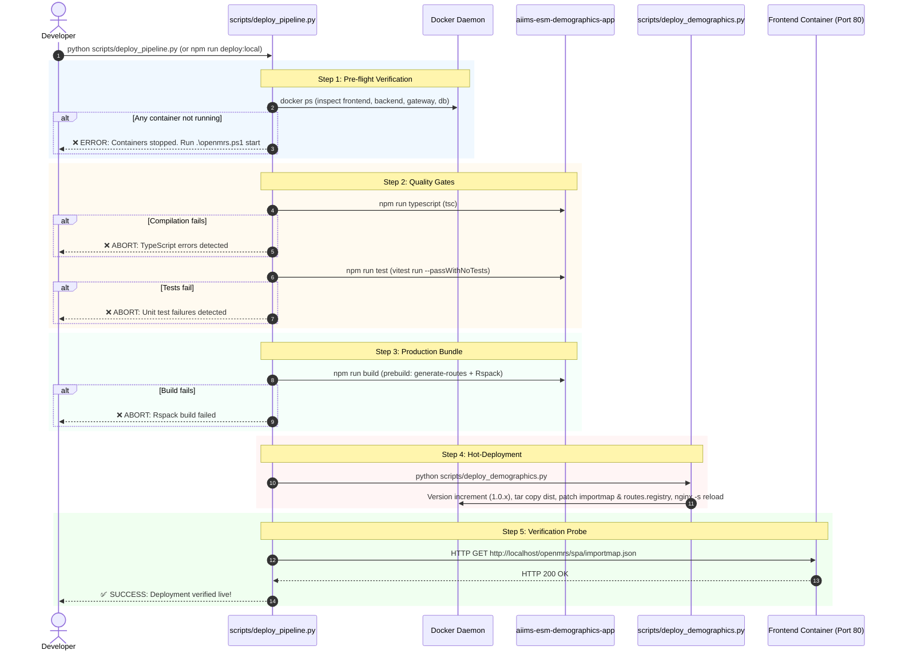

# Comprehensive Implementation Plan: Phase 3 (Thin 1-Click Deploy Pipeline)

> **Objective:** Deliver a lightweight, robust, one-command deployment pipeline (`npm run deploy:local` / `python scripts/deploy_pipeline.py`) that executes Docker pre-flight validation, type checking, unit tests, production bundling, hot-deployment via the existing `scripts/deploy_demographics.py`, and confirms live availability via an HTTP 200 probe.

---

## 1. System Architecture & Flow



---

## 2. Low-Level Design: `scripts/deploy_pipeline.py`

### Key Design Principles:
1. **Wrap, Do Not Rewrite**: Directly invokes `scripts/deploy_demographics.py` via `sys.executable` to preserve existing tested cache-busting and container copy logic.
2. **Fast-Fail Quality Gates**: If `tsc` or `vitest` fails, the pipeline aborts immediately before building or modifying any container state.
3. **Cross-Platform Compatibility**: Uses Python standard library (`subprocess`, `urllib.request`, `os`, `sys`, `time`) to run uniformly on Windows PowerShell, CMD, and Linux without shell-specific token issues (e.g. `&&` vs `;`).
4. **Terminal UX**: Colored output with step numbers, durations, and clear troubleshooting instructions on failure.

### Implementation Breakdown

```python
"""
scripts/deploy_pipeline.py
One-click deployment pipeline for AIIMS OpenMRS 3.x Frontend Microfrontends.
"""
```

#### Step 1: Pre-flight Checks (`check_docker_environment()`)
- Execute: `docker ps --format "{{.Names}}\t{{.Status}}"`
- Verify presence of active containers:
  - `openmrs-distro-referenceapplication-frontend-1` (or matching `frontend`)
  - `openmrs-distro-referenceapplication-backend-1` (or matching `backend`)
  - `openmrs-distro-referenceapplication-gateway-1` (or matching `gateway`)
  - `openmrs-distro-referenceapplication-db-1` (or matching `db`)
- If any container is missing:
  - Print explicit guidance: `[ERROR] Required Docker containers are not running. Please run .\openmrs.ps1 start or .\openmrs.ps1 setup.`
  - Exit code 1.

#### Step 2: Quality Gate: Type Checking (`run_typecheck()`)
- Working Directory: `./aiims-esm-demographics-app`
- Command: `npm run typescript` (which invokes `tsc`)
- Failure handling: Print compiler errors and exit code 1.

#### Step 3: Quality Gate: Unit Tests (`run_tests()`)
- Working Directory: `./aiims-esm-demographics-app`
- Command: `npm run test` (which invokes `vitest run --passWithNoTests`)
- Failure handling: Print test failures and exit code 1.
- CLI override: Support `--skip-tests` flag for rapid iterative styling changes when explicitly requested.

#### Step 4: Production Build (`run_build()`)
- Working Directory: `./aiims-esm-demographics-app`
- Command: `npm run build`
- This triggers:
  1. `prebuild` hook (`npm run generate-routes` -> updates `src/routes.json` with all 53 extensions)
  2. `rspack --mode production` -> creates bundle in `dist/`
- Failure handling: Print Rspack build error and exit code 1.

#### Step 5: Container Deployment (`run_deploy_script()`)
- Execute: `sys.executable scripts/deploy_demographics.py`
- Inherit/stream stdout and stderr so the user observes version incrementation and container patch steps.
- Failure handling: Check returncode == 0.

#### Step 6: Live Verification Probe (`verify_endpoint()`)
- Endpoint: `http://localhost/openmrs/spa/importmap.json`
- Timeout: 5 seconds per request.
- Retry logic: Up to 3 attempts with 1-second pause to allow Nginx reload to complete.
- Verify status code: Must be `200`.
- Failure handling: Print endpoint error and exit code 1.

---

## 3. Package Configuration: `package.json`

Add convenience scripts to `aiims-esm-demographics-app/package.json`:

```json
{
  "scripts": {
    "deploy:local": "python ../scripts/deploy_pipeline.py",
    "deploy:local:fast": "python ../scripts/deploy_pipeline.py --skip-tests"
  }
}
```

This allows the developer to deploy from either location:
- In `aiims-esm-demographics-app`: `npm run deploy:local`
- In project root: `python scripts/deploy_pipeline.py`

---

## 4. Error Handling & Edge Cases

| Scenario | Behavior | Resolution / User Guidance |
|---|---|---|
| Docker daemon stopped | `check_docker_environment` catches `subprocess.CalledProcessError` or timeout | Prints `[ERROR] Docker daemon is not running.` |
| Containers stopped | Missing container in `docker ps` output | Prints `[ERROR] OpenMRS stack stopped. Run .\openmrs.ps1 start` |
| TypeScript error | `npm run typescript` exits non-zero | Aborts pipeline; prints file line and compilation error |
| Test failure | `npm run test` exits non-zero | Aborts pipeline; prints failed Vitest suite |
| Rspack bundle failure | `npm run build` exits non-zero | Aborts pipeline; prints bundling error |
| `deploy_demographics.py` error | Docker exec/tar copy failure | Prints Docker error; aborts before probe |
| Probe returns non-200 | HTTP probe fails after 3 attempts | Prints HTTP status; advises checking `docker logs gateway-1` |

---

## 5. Acceptance Test & Verification Procedure

1. **Dry/Live Run Execution**:
   ```bash
   python scripts/deploy_pipeline.py
   ```
2. **Verification Checklist**:
   - [ ] Docker pre-flight passes and identifies all 4 containers.
   - [ ] Type check passes (`0 errors`).
   - [ ] Vitest test suite passes (`29 test files, 71 tests passed`).
   - [ ] Rspack build passes and produces `dist/`.
   - [ ] `deploy_demographics.py` increments patch version (e.g. `1.0.8 -> 1.0.9`) and reloads Nginx.
   - [ ] HTTP probe receives `200 OK` from `http://localhost/openmrs/spa/importmap.json`.
   - [ ] Entire pipeline completes with green summary and total duration.
3. **Workspace Documentation**:
   - Update `PROJECT_MEMORY.md` and `AGENTS.md` to document the new `npm run deploy:local` workflow.
4. **Git State**:
   - Verify working tree is clean.

---

## 6. Execution Timeline

- **Script Creation (`scripts/deploy_pipeline.py`)**: ~10 minutes
- **Package Wiring (`package.json`)**: ~2 minutes
- **Live Execution & Verification Probe**: ~2 minutes
- **Documentation (`PROJECT_MEMORY.md`)**: ~3 minutes
- **Total Estimated Effort**: ~15–20 minutes
