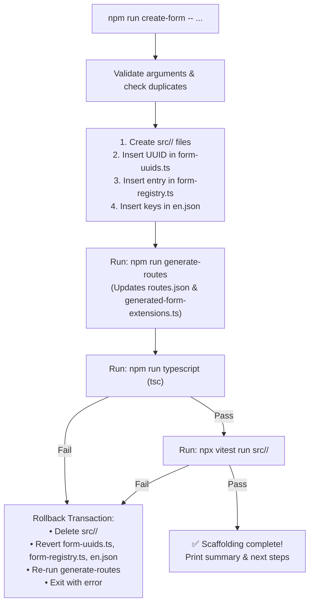

# Comprehensive Implementation Plan: Phase 1 (Form Scaffolding CLI)

> **Objective:** Deliver an automated form scaffolding tool (`npm run create-form`) that generates complete, working starter files, registers UUIDs, updates configuration, and generates routes in seconds with zero boilerplate and automated rollback on failure.

---

## 1. Architecture: Deriving Registration from `FORM_REGISTRY`

### The Problem
Historically, adding a single form touched **6 files**:
1. `src/config/form-uuids.ts` (UUID & Name constants)
2. `src/config/form-registry.ts` (`FORM_REGISTRY` entry)
3. `src/index.ts` (`FORM_MODULES` loader mapping)
4. `src/index.ts` (Named exports destructuring for Single-SPA)
5. `src/index.ts` (Feature barrel re-export)
6. `translations/en.json` (Translation strings)
*(Note: `src/routes.json` is already 100% automated via `scripts/generate-routes.ts`)*

### The Solution: Preparatory Refactor
We will expand `scripts/generate-routes.ts` so that during `prebuild`, it generates **both**:
1. `src/routes.json` (OpenMRS Single-SPA slot routing metadata)
2. `src/generated-form-extensions.ts` (Static Single-SPA extension lifecycle bindings and named exports)

#### How `src/generated-form-extensions.ts` Works:
```typescript
// AUTO-GENERATED by scripts/generate-routes.ts. Do not edit manually.
import { getAsyncLifecycle, getSyncLifecycle } from '@openmrs/esm-framework';
import { createDashboardLink } from './shared/components/dashboard-link.component';
import { FORM_REGISTRY, moduleName } from './constants';

// Generated per entry in FORM_REGISTRY:
export const aiimsDemographicsDashboardLink = getSyncLifecycle(
  createDashboardLink({ path: 'aiims-demographics', title: 'AIIMS Demographics', ... }),
  { featureName: 'demographics', moduleName, order: 1 }
);
export const aiimsDemographicsDashboard = getAsyncLifecycle(
  () => import('./demographics/demographics-dashboard.component'),
  { featureName: 'demographics', moduleName, order: 1 }
);
export * from './demographics';
```

In `src/index.ts`, the entire manual 100-line `FORM_MODULES` manifest and export block is replaced with:
```typescript
export * from './generated-form-extensions';
```

#### Directory Name Exceptions:
Two historical forms have directory names that differ from their key:
- `key: 'female-blood-hormone'` -> directory: `investigation-female-blood`
- `key: 'female-surgical-procedure'` -> directory: `investigation-female-surgical`

We add an optional field `dir?: string` to `FormRegistryEntry` in `src/shared/types.ts`:
```typescript
export interface FormRegistryEntry {
  key: string;
  uuid: string;
  name: string;
  dir?: string; // Optional directory override; defaults to key
  path: string;
  ...
}
```
If `entry.dir` is defined, the generator imports from `./${entry.dir}/...`; otherwise, it defaults to `./${entry.key}/...`.

#### Result of Preparatory Refactor:
- `src/index.ts` and `src/routes.json` **never need manual edits again**.
- The scaffolder only needs to update:
  1. `src/config/form-uuids.ts`
  2. `src/config/form-registry.ts`
  3. `translations/en.json`
  4. Create `src/<key>/` with starter files.

---

## 2. Low-Level Design: `scripts/create-form.ts`

### 2.1 CLI Syntax & Options
```bash
npm run create-form -- <key> "<Form Name>" [--icon=IconName] [--concepts=c1,c2] [--keep-on-fail]
```

- `<key>`: Kebab-case identifier (e.g. `cervical-cancer-screening`).
- `<Form Name>`: Human-readable title (e.g. `AIIMS Visit: Cervical Cancer Screening`).
- `--icon`: Carbon icon name from `@carbon/react/icons` (default: `ReportData`). Validates against exported icons.
- `--concepts`: Optional comma-separated list of concept UUIDs to pre-populate in resource.
- `--keep-on-fail`: Debugging flag; skips automatic rollback if `tsc` or `vitest` fails.

### 2.2 Dynamic Order Computation
The script imports `FORM_REGISTRY` and calculates:
```typescript
const maxOrder = Math.max(...FORM_REGISTRY.map(e => e.order || 0), 0);
const nextOrder = maxOrder + 1;
```

### 2.3 Explicit Marker Comments
To eliminate fragile string search/replace, we place explicit marker comments:

In `src/config/form-uuids.ts`:
```typescript
// @create-form:uuids-end
```
In `src/config/form-registry.ts`:
```typescript
// @create-form:registry-end
```

The scaffolder inserts new entries immediately before these markers.

### 2.4 Starter Files Generated in `src/<key>/`

#### 1. `src/<key>/<key>.resource.ts`
- Imports from `../config/form-uuids` and `../config/concepts` (not `../constants`).
- Exports strictly-typed `Aiims<Pascal>Data` interface.
- Explicitly marks stub as unfinished:
  ```typescript
  export const initialAiims<Pascal>Data: Readonly<Aiims<Pascal>Data> =
    Object.freeze({
      hasData: false, // Default: false until clinical concepts are mapped
    });
  ```
- Clear TODO comments guiding concept mapping.

#### 2. `src/<key>/<key>-card.component.tsx`
- Renders Carbon `ObservationCard` with icon and header title.
- Placeholder `DataRow` with clear TODO comments for adding clinical observation rows.

#### 3. `src/<key>/<key>-dashboard.component.tsx`
- Wraps `FormDashboardShell`.
- Supplies all 8 standard localized props:
  - `loadingDescription`: `t('loading<Pascal>', 'Loading <Form Name>...')`
  - `emptyHeading`: `t('noRecorded<Pascal>Encounter', 'No <Form Name> encounter recorded yet')`
  - `emptyDescription`: `t('no<Pascal>Body', 'No clinical intake details have been submitted for this patient yet.')`
  - `noRecordedText`: `t('no<Pascal>Recorded', 'No <Form Name> recorded')`
  - `recordButtonText`: `t('record<Pascal>', 'Record <Form Name>')`
  - `updateButtonText`: `t('update<Pascal>', 'Update <Form Name>')`

#### 4. `src/<key>/<key>.test.tsx`
- Clean imports: `render, screen` from `@testing-library/react`, `describe, it, expect` from `vitest` (no unused `vi`).
- Mocks `react-i18next` and `FormDashboardShell`.
- Asserts:
  1. Card renders header title.
  2. Dashboard renders empty state heading when `hasData: false`.

#### 5. `src/<key>/index.ts`
- Barrel export for the feature module.

### 2.5 Translations (`translations/en.json`)
Appends all 8 required translation keys directly before the closing `\n}` of `translations/en.json`:
- `aiims<Pascal>Title`: `"<Form Name>"`
- `<camel>Details`: `"<Form Name> Details"`
- `loading<Pascal>`: `"Loading <Form Name>..."`
- `noRecorded<Pascal>Encounter`: `"No <Form Name> encounter recorded yet"`
- `no<Pascal>Body`: `"No clinical intake details have been submitted for this patient yet."`
- `no<Pascal>Recorded`: `"No <Form Name> recorded"`
- `record<Pascal>`: `"Record <Form Name>"`
- `update<Pascal>`: `"Update <Form Name>"`

Does **not** re-sort the entire JSON file, keeping git diffs minimal and clean.

---

## 3. Transactional Rollback & Safety



If `--keep-on-fail` is passed, the rollback is skipped so the developer can inspect the compiler error.

---

## 4. Execution Steps

### Step 1: Preparatory Registration Refactor
1. Update `src/shared/types.ts`: add `dir?: string` to `FormRegistryEntry`.
2. Update `src/config/form-registry.ts`: add `dir` to `female-blood-hormone` and `female-surgical-procedure`.
3. Update `scripts/generate-routes.ts`: generate `src/generated-form-extensions.ts` alongside `src/routes.json`.
4. Update `src/index.ts`: replace manual manifests with `export * from './generated-form-extensions';`.
5. Run `npm run typescript && npm test && npm run build` to verify zero regression.

### Step 2: Implement Scaffolder CLI
1. Add marker comments `// @create-form:uuids-end` and `// @create-form:registry-end`.
2. Implement `scripts/create-form.ts` with templates, argument parser, rollback logic, and validation.
3. Add `"create-form": "tsx scripts/create-form.ts"` to `package.json`.

---

## 5. Acceptance Test Procedure

1. **Scaffold Dummy Form**:
   ```bash
   npm run create-form -- dummy-test "AIIMS Visit: Dummy Test" --icon=Activity
   ```
2. **Verify Generated State**:
   - `src/dummy-test/` exists with 5 starter files.
   - `src/config/form-uuids.ts` contains `AIIMS_DUMMY_TEST_FORM_UUID`.
   - `src/config/form-registry.ts` contains `dummy-test` entry with dynamic order.
   - `src/routes.json` contains `dummy-test` link and dashboard extensions.
   - `src/generated-form-extensions.ts` contains `aiimsDummyTestDashboardLink` and `aiimsDummyTestDashboard`.
   - `translations/en.json` contains all 8 translation keys.
3. **Verify Quality Gates**:
   - `npm run typescript` passes (0 errors).
   - `npx vitest run src/dummy-test/` passes (2/2 tests passed).
4. **Verify Rollback**:
   - Revert dummy form edits or run rollback test.
   - Confirm `git status` is clean.
5. **Update Documentation**:
   - Update `PROJECT_MEMORY.md` documenting `npm run create-form` usage.
