# Comprehensive Implementation Plan: Phase 5 (Minimal E2E Smoke Test Robot)

> **Objective:** Deliver a resilient, headless E2E smoke testing robot (`npm run test:e2e`) that verifies all registered clinical encounter dashboards load properly in a real patient chart without blank screens or Single-SPA registration failures.

---

## 1. System Architecture & Flow

```mermaid
sequenceDiagram
    autonumber
    actor Dev as Developer / CI
    participant E2E as e2e/smoke-test.ts
    participant Docker as OpenMRS Docker Stack
    participant Chrome as Headless Chromium
    participant SPA as Single-SPA Patient Chart

    Dev->>E2E: npm run test:e2e

    rect rgb(240, 248, 255)
        Note over E2E,Docker: Step 1: Pre-flight Preconditions
        E2E->>Docker: GET http://localhost/openmrs/spa (Check stack alive)
        alt Stack unreachable
            E2E-->>Dev: ❌ Precondition Failed: OpenMRS is not running. Run .\openmrs.ps1 start
        end
        E2E->>Docker: GET /ws/rest/v1/patient/1d678f66-801a-4a52-b47f-29854389c09f (Check test patient)
        alt Patient not found
            E2E->>Docker: Fallback: query GET /ws/rest/v1/patient?limit=1
        end
    end

    rect rgb(255, 250, 240)
        Note over E2E,Chrome: Step 2: Headless Browser Launch & Auth
        E2E->>Chrome: Launch Chromium (headless)
        E2E->>Chrome: Authenticate session (admin / Admin123)
        E2E->>Chrome: Navigate to /openmrs/spa/patient/{uuid}/chart
    end

    rect rgb(245, 255, 250)
        Note over E2E,SPA: Step 3: Iterate All Forms in FORM_REGISTRY
        loop For each entry in FORM_REGISTRY (26 forms)
            E2E->>SPA: Navigate to /chart/${entry.path}
            SPA->>SPA: Single-SPA resolves named dashboard extension
            E2E->>SPA: Assert container rendered (tile / shell / empty state)
            E2E->>SPA: Assert body text > 50 chars & no React fatal boundary
            alt Form passes
                E2E-->>Dev: ✓ [1/26] AIIMS Demographics ... OK (0.6s)
            else Form crashes / blank
                E2E->>Chrome: Capture failure screenshot to e2e-screenshots/<key>.png
                E2E-->>Dev: ❌ [X/26] Form crashed: White screen detected!
            end
        end
    end

    rect rgb(240, 255, 240)
        Note over E2E,Dev: Step 4: Summary & Exit Code
        E2E-->>Dev: 🎉 All 26 forms passed smoke test!
    end
```



---

## 2. Low-Level Design

### 2.1 Preconditions & Fast-Fail Health Checks
Before launching a browser, the script validates preconditions to prevent hanging or confusing timeout errors:
1. **OpenMRS Frontend & Backend Availability**:
   - HTTP GET `http://localhost/openmrs/spa` must return HTTP 200.
   - HTTP GET `http://localhost/openmrs/ws/rest/v1/session` must return HTTP 200.
   - If unreachable: fails immediately with instructions to run `.\openmrs.ps1 start`.
2. **Stable Test Patient Verification**:
   - Known verified patient UUID: `1d678f66-801a-4a52-b47f-29854389c09f` ("10001MJ - Bereal Atul").
   - If not found: queries `/ws/rest/v1/patient?limit=1` to auto-discover any existing active patient.
   - If no patients exist: fails with instructions to run `python scripts/setup_environment.py`.

### 2.2 Headless Browser, Fallbacks & Authentication
- **Engine**: Playwright Chromium (default headless).
  - Falls back to `channel: 'chrome'` if Playwright's local Chromium download is not present, utilizing the host machine's installed Google Chrome (`C:\Program Files\Google\Chrome\Application\chrome.exe`).
- **Interactive Debugging**: Supports `--headed` flag to run with a visible browser window during local troubleshooting.
- **Selective Testing**: Supports `--form=<key>` (or `-f <key>`) to run smoke testing against a single form rather than all 26.
- **Authentication**:
  - Authenticates against `/openmrs/spa/login` with credentials (`admin` / `Admin123`).
  - Handles session location selection automatically if prompted (selecting the first available location).
  - Retains authenticated session state across all dashboard route navigations.
- **Viewport**: 1280 × 800 standard desktop viewport.

### 2.3 Dynamic Execution Driven by `FORM_REGISTRY`
The test script directly imports `FORM_REGISTRY` from `src/config/form-registry.ts`:
```typescript
import { FORM_REGISTRY } from '../src/config/form-registry';
```
- Iterates over all 26 existing entries.
- Automatically covers future forms created by `npm run create-form` with **zero test code changes**.

### 2.4 Smoke Assertions & Blank Screen Detection
For each form in `FORM_REGISTRY`:
1. Navigates to `http://localhost/openmrs/spa/patient/${patientUuid}/chart/${entry.path}`.
2. Waits for page mount (DOM loaded, selector `.omrs-main-content`, `main`, or dashboard root container).
3. **Asserts Non-Blank Screen**:
   - Visible text content inside the main content area must exceed 30 characters.
   - No fatal React unhandled error boundary (`"Something went wrong"`, `"Minified React error"`, `"Application Error"`).
4. **Asserts Dashboard Mount**:
   - Either the Carbon `ObservationCard` tiles render OR the `EmptyState` component (`<h3>` header / "Record" button) is visible.
5. **No False Positives on `console.error`**:
   - As directed in the review, `console.error` assertions are deliberately **omitted** initially to avoid test flakiness from harmless upstream OpenMRS warnings.

### 2.5 Failure Capture & Diagnostics
If an assertion fails:
- Immediately captures full-page screenshot to `e2e-screenshots/${entry.key}-failure.png`.
- Logs the exact failed URL, entry path, and DOM snippet.
- Reports total passed vs failed forms at the end of the run.
- Exits with code `1` if any form failed, or `0` if all passed.

---

## 3. Package Wiring & Dependencies

### Dependencies
Add `playwright` to `devDependencies` in `aiims-esm-demographics-app/package.json`:
```json
{
  "devDependencies": {
    "playwright": "^1.50.0"
  }
}
```

### NPM Script
In `aiims-esm-demographics-app/package.json`:
```json
{
  "scripts": {
    "test:e2e": "tsx e2e/smoke-test.ts"
  }
}
```

---

## 4. Execution Steps

1. **Install Playwright**:
   - Run `npm install -D playwright` in `aiims-esm-demographics-app`.
   - Install Chromium browser if needed (`npx playwright install chromium`).
2. **Implement `e2e/smoke-test.ts`**:
   - Pre-flight checks (OpenMRS ping + patient fetch).
   - Session authentication with location handling.
   - Loop over `FORM_REGISTRY` with non-blank / dashboard mount assertions.
   - CLI flags: `--form=<key>`, `--headed`, `--timeout=<ms>`.
   - Screenshot capture on failure (`e2e-screenshots/`).
3. **Wire NPM Scripts**:
   - Add `"test:e2e": "tsx e2e/smoke-test.ts"`.
4. **Run Live Acceptance Test**:
   - Run `npm run test:e2e`.
   - Verify all 26 forms report clean pass.
5. **Update Documentation**:
   - Document `npm run test:e2e` in `PROJECT_MEMORY.md`.

---

## 5. Acceptance Criteria

1. Pre-flight check correctly confirms OpenMRS stack is running and identifies test patient `1d678f66-801a-4a52-b47f-29854389c09f`.
2. Script runs headlessly, iterating through all 26 registered forms.
3. Every dashboard is asserted to render without white screens or fatal React crashes.
4. Clean terminal output reporting progress for each form and total elapsed time.
5. Exit code 0 on success.
