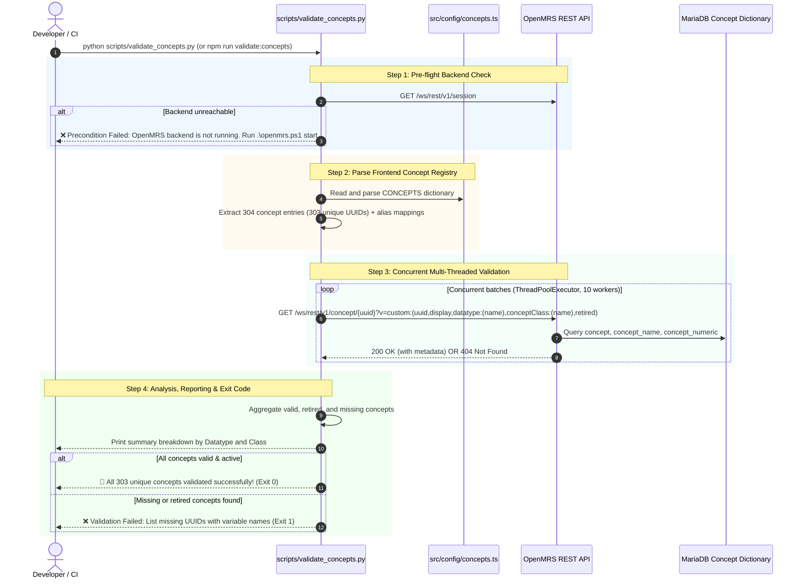

# Comprehensive Implementation Plan: Phase 4 (Minimal Concept Validator)

> **Objective:** Deliver a fast, multi-threaded concept validation tool (`scripts/validate_concepts.py` and `npm run validate:concepts`) that parses all concept definitions in `src/config/concepts.ts`, verifies their existence, retirement status, and datatypes against the live OpenMRS backend, and reports actionable discrepancies to prevent silent observation save failures.

---

## 1. System Architecture & Flow



---

## 2. Low-Level Design

### 2.1 Concept Extraction from Frontend Code
- **Target File**: `aiims-esm-demographics-app/src/config/concepts.ts`.
- **Parsing Strategy**: Regex-based parser scanning `CONCEPTS = { ... }` object literal:
  - Extracts key name and concept UUID: `(\w+):\s*['"]([0-9a-fA-F-]+)['"]`.
  - Maps duplicate UUIDs (e.g. `educationLevel` and `educationWife` both referencing `1712AAAAAAAAAAAAAAAAAAAAAAAAAAAAAAAA`) to a list of variable names.
  - Validates UUID syntax (standard 36-char hyphenated UUID or 32-char CIEL legacy format).

### 2.2 Pre-flight Health & Connectivity
Before initiating bulk concept validation:
- Validates `http://localhost/openmrs/ws/rest/v1/session` with Basic Auth (`admin` / `Admin123`).
- Fails fast in < 1 second if OpenMRS is not running, with an actionable remediation message (`powershell .\openmrs.ps1 start`).

### 2.3 High-Performance Concurrent Verification
- Sequentially querying 303 concepts would take ~15 seconds.
- Using Python's `concurrent.futures.ThreadPoolExecutor(max_workers=10)` reduces total execution time to **~3-5 seconds**.
- **REST Endpoint**:
  `GET /openmrs/ws/rest/v1/concept/{uuid}?v=custom:(uuid,display,datatype:(name),conceptClass:(name),retired)`
- **Response Validation**:
  - `HTTP 200`: Concept exists in OpenMRS dictionary.
  - `data['retired'] == True`: Flagged as warning/error (retired concepts cannot receive new observations).
  - `HTTP 404`: Concept is missing from OpenMRS dictionary.
  - `HTTP 500 / Connection Error`: Flagged as server error.

### 2.4 Reporting & Diagnostics
The script produces clean, structured console output:
1. **Progress Bar / Counter**: Shows progress during execution.
2. **Datatype Breakdown**: Groups verified concepts by OpenMRS datatype (`Coded`, `Numeric`, `Text`, `Date`, `Datetime`, `N/A`).
3. **Class Breakdown**: Groups concepts by OpenMRS concept class (`Question`, `Finding`, `Misc`, `Procedure`, etc.).
4. **Issue Table**: If any concept fails:
   - Variable name in `concepts.ts`
   - UUID
   - Failure reason (404 Missing, Retired, Invalid UUID format)
5. **Exit Codes**:
   - `0`: All concepts exist and are active.
   - `1`: One or more concepts are missing or retired.

### 2.5 CLI Arguments & Options
Supports developer CLI flags:
- `--host=<url>`: Base URL (default: `http://localhost/openmrs`).
- `--workers=<int>`: Concurrency worker pool size (default: `10`).
- `--verbose` / `-v`: Prints every concept's resolved display name and datatype.
- `--fail-on-retired`: Enforces failure if any concept is retired (default: `true`).

---

## 3. Package Wiring & Developer Ergonomics

### NPM Script Integration
In `aiims-esm-demographics-app/package.json`:
```json
{
  "scripts": {
    "validate:concepts": "python ../scripts/validate_concepts.py"
  }
}
```

---

## 4. Execution Steps

1. **Implement `scripts/validate_concepts.py`**:
   - Pre-flight connection probe.
   - `concepts.ts` parser.
   - Concurrent REST validation worker with connection pooling.
   - Formatted ANSI summary tables with Windows `cp1252` encoding safety.
2. **Wire Script in `aiims-esm-demographics-app/package.json`**:
   - Add `"validate:concepts": "python ../scripts/validate_concepts.py"`.
3. **Run Live Acceptance Test**:
   - Execute `python scripts/validate_concepts.py` and `npm run validate:concepts`.
   - Verify all 304 entries / 303 unique UUIDs pass against the running backend.
4. **Update Documentation**:
   - Document `npm run validate:concepts` in `PROJECT_MEMORY.md`.

---

## 5. Acceptance Criteria

1. Pre-flight check correctly confirms OpenMRS REST API availability.
2. Accurately parses all concept entries from `src/config/concepts.ts`.
3. Validates all unique UUIDs concurrently within < 10 seconds.
4. Generates a structured summary displaying total concepts, datatype distributions, and retirement status.
5. Returns exit code 0 when all concepts are valid and active.
