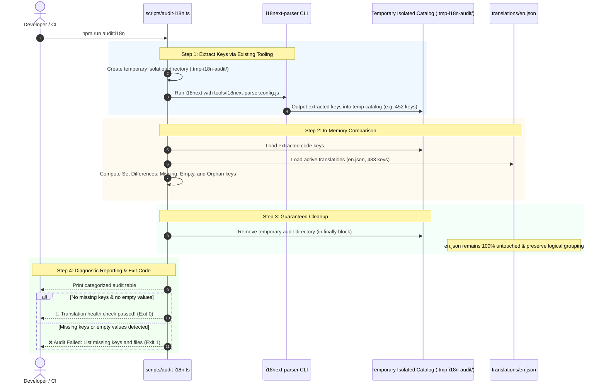

# Comprehensive Implementation Plan: Phase 2 (i18n Translation Health Check)

> **Objective:** Deliver a non-destructive translation audit CLI (`scripts/audit-i18n.ts` and `npm run audit:i18n`) that leverages the repository's existing `i18next-parser` configuration (`tools/i18next-parser.config.js`) to guarantee 100% translation completeness, detecting missing keys and empty values before deployment without scrambling or overwriting the logical structure of `translations/en.json`.

---

## 1. System Architecture & Flow



---

## 2. Low-Level Design

### 2.1 Non-Destructive Extraction via `i18next-parser`
Direct execution of `extract-translations` overwrites and alphabetically scrambles `translations/en.json`, destroying the logical form groupings and creating massive noisy git diffs.

To prevent this:
1. `scripts/audit-i18n.ts` invokes the existing `i18next` parser using a CLI override for the output path:
   ```bash
   npx i18next 'src/**/*.component.tsx' 'src/**/*.extension.tsx' 'src/**/*.modal.tsx' 'src/**/*.workspace.tsx' 'src/index.ts' \
     --config ./tools/i18next-parser.config.js \
     --output .tmp-i18n-audit/$LOCALE.json \
     --silent
   ```
2. The extracted keys are parsed from `.tmp-i18n-audit/` into memory.
3. The temporary folder is immediately deleted in a `finally` block, ensuring zero filesystem debris even if the script crashes.

### 2.2 Translation Discrepancy Categories
The tool compares the code-extracted set ($C$) with the `en.json` catalog set ($E$):

1. **Missing Translation Keys** ($C \setminus E$):
   - **Severity**: 🚨 **Error (Exit Code 1)**.
   - **Impact**: Keys used in `t('...')` that are completely missing from `en.json`. At runtime, OpenMRS will display raw translation keys to clinicians (e.g. `aiimsAdjuvantDrugTitle` instead of `Adjuvant Drug`).
2. **Empty Translation Values** ($k \in E$ where $E[k] == ""$):
   - **Severity**: 🚨 **Error (Exit Code 1)**.
   - **Impact**: Keys that exist in `en.json` but have blank values (`""`), causing UI labels or table columns to render as blank space.
3. **Orphan / Unused Keys** ($E \setminus C$):
   - **Severity**: ℹ️ **Notice / Informational** (Error only when `--strict` is enabled).
   - **Impact**: Keys present in `en.json` that are not directly referenced in component files (e.g. dynamically computed keys or legacy keys).

### 2.3 CLI Flags & Developer Ergonomics
- `npm run audit:i18n`: Standard audit. Fails on missing keys or empty values.
- `npm run audit:i18n -- --strict`: Strict audit. Fails on missing keys, empty values, OR orphan keys.
- `npm run audit:i18n -- --fix`: Safe append mode. Appends missing keys with empty strings or default values to `translations/en.json` in-place without re-sorting existing keys.

---

## 3. Package Wiring & Dependencies

### Dependencies
No new npm dependencies required (`i18next-parser` is already present in `devDependencies`).

### NPM Script Integration
In `aiims-esm-demographics-app/package.json`:
```json
{
  "scripts": {
    "audit:i18n": "tsx scripts/audit-i18n.ts"
  }
}
```

---

## 4. Execution Steps

1. **Implement `scripts/audit-i18n.ts`**:
   - Create isolated temporary output directory.
   - Execute `i18next` parser via `child_process`.
   - Read extracted keys from temporary catalog.
   - Compare against `translations/en.json`.
   - Guaranteed cleanup of temporary directory in `finally`.
   - Render clean diagnostic output with summary statistics.
2. **Wire Script in `package.json`**:
   - Add `"audit:i18n": "tsx scripts/audit-i18n.ts"`.
3. **Run Live Acceptance Test**:
   - Run `npm run audit:i18n`.
   - Verify all 450+ keys are evaluated and output reports clean pass.
4. **Update Documentation**:
   - Add `npm run audit:i18n` to `PROJECT_MEMORY.md`.

---

## 5. Acceptance Criteria

1. Leverages the existing `tools/i18next-parser.config.js` with zero custom AST/regex duplication.
2. `translations/en.json` is never overwritten, scrambled, or sorted by the audit.
3. Temporary extraction artifacts are cleanly removed upon completion.
4. Correctly flags any missing translation keys or empty values.
5. Clean terminal output reporting total keys checked, valid translations, and discrepancy breakdowns.
6. Returns exit code 0 when all keys are complete and non-empty.
