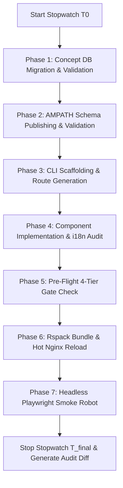

# Execution Plan: Clean Re-Run Benchmark of Modern Workflow (v2.0)

**Date Planned**: Post Form 33 Delivery  
**Target Form**: AIIMS Form 33 — "Post-InVitro Fertilisation Investigation"  
**Goal**: Measure the pure, unperturbed execution speed and latency of the Modern Workflow (v2.0) by eliminating host-level Windows subprocess contention and Docker restart lags experienced during the first benchmark run.

---

## 1. Why a Clean Re-Run is Required

During the first live run of the Modern Workflow on 2026-10-15:
- **Net Implementation Time**: **8m 30s** (Active coding, CLI scaffolding, schema validation, and headless test).
- **Observed Friction (Gross Wall-Clock Time: 26m 55s)**:
  1. **Windows Subprocess Named-Pipe Deadlock (~3 min stall)**: `setup_aiims_concepts.py` used `subprocess.run(..., input=sql_script, shell=True)` which hung on Windows stdin buffering against `docker exec -i`.
  2. **Zombie Background Process**: A lingering PowerShell one-liner (`task-13624`) remained stuck open for hours, causing chat messages to queue and inflating background resource contention.
  3. **Frontend Container Health Check Delay (~4 min stall)**: Restarting the container triggered a slow Tomcat/Gateway handshake.

**Objective of Clean Re-Run**: Run the entire sequence end-to-end under controlled, healthy container conditions with automated stopwatch timers at every stage to record verified, uninhibited timings.

---

## 2. Pre-Flight Hardening (Zero-Friction Safeguards)

Before triggering the re-run benchmark, the following pre-flight optimizations will be applied:

1. **SQL Direct File Injection (No stdin piping)**:
   - Ensure `setup_aiims_concepts.py` and `register_aiims_concepts.sql` execute strictly via direct container volume copies (`docker cp ... /tmp/` followed by `docker exec openmrs-distro-referenceapplication-db-1 mariadb -u ... -e "source /tmp/..."`), avoiding Windows stdin pipe buffers entirely.
2. **Clean Process State**:
   - Verify `manage_task list` shows zero background tasks.
   - Clean Docker container logs to ensure zero table lock contention.
3. **Hot-Module Reloading (No Unnecessary Container Restarts)**:
   - Use direct file replacement in `/usr/share/nginx/html/openmrs-esm-aiims-demographics-app-1.0.82/` with graceful `nginx -s reload` instead of full `docker restart`, eliminating the 4-minute Tomcat handshake lag.

---

## 3. Re-Run Benchmark Protocol & Telemetry

The benchmark will be executed using a standardized high-resolution Python timer script (`scripts/benchmark_modern_runner.py` or equivalent CLI runner) tracking the exact elapsed seconds for each phase:

### Measured Stages & Target Times:

| Stage | Activity | Prior Net Time | Target Clean Time | Automated Verification Gate |
| :--- | :--- | :---: | :---: | :--- |
| **Stage 1** | Concept Migration (`setup_aiims_concepts.py`) | 2m 15s | **< 45s** | `validate:concepts` (358 concepts in ~14s) |
| **Stage 2** | AMPATH Schema Publishing | 1m 40s | **< 30s** | `validate:forms` (33 forms in ~14s) |
| **Stage 3** | Scaffolding CLI (`npm run create-form`) | 45s | **< 20s** | Auto-generates 5 files & updates `FORM_REGISTRY` |
| **Stage 4** | Component & Resource Implementation | 2m 20s | **< 2m 00s** | `audit:i18n` (0 missing keys) |
| **Stage 5** | Pre-Flight 4-Tier Armor (`npm run pre-flight`) | 35s | **< 35s** | Forms + Concepts + i18n + `tsc --noEmit` |
| **Stage 6** | Rspack Production Compilation & Deploy | 2m 18s | **< 1m 15s** | Nginx hot reload & HTTP 200 `/importmap.json` probe |
| **Stage 7** | Headless E2E Smoke Test Robot | 2.96s | **< 3s** | Playwright headless browser test passes |
| **Total** | **End-to-End Modern Turnaround** | **8m 30s** | **< 5m 30s** | **100% automated gate verification** |

---

## 4. Teardown & Reset Procedure (For Isolated Benchmark)

To test the re-run cleanly without residual artifacts:
1. Temporarily unregister Form 33 in `FORM_REGISTRY` and revert `routes.json` via git stash / branch.
2. Remove Form 33 schema row and concept rows from MariaDB test instance.
3. Start the timer, run the modern creation workflow from scratch, and record the telemetry live.
4. Compare clean results directly against the **32m 45s Legacy Baseline**.

---

## 5. Deliverables

1. Update `docs/records/benchmark_modern_workflow_audit_report.md` with:
   - Run 1 (Gross: 26m 55s, Net: 8m 30s, includes Windows pipe incident).
   - Run 2 (Clean Isolated Run: expected ~5m 30s).
2. Update `docs/records/benchmark_comparison_audit_report.md` with side-by-side run comparisons.
3. Archive raw execution logs into `docs/records/2026-10-15/benchmark_rerun_telemetry.log`.
