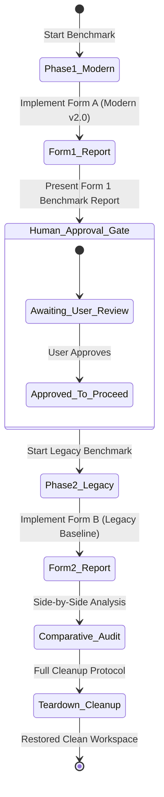

# Benchmark Execution Plan: Controlled Comparative Re-Run (Modern vs. Legacy Workflow)

**Target Clinical Specification**: AIIMS Fresh Embryo Transfer Details Sheet  
**Specification Source**: [`csv/aiims_ivf_04 copy - freshET_details.csv`](file:///c:/Met4l.DSCode/Projects/open-mrs/csv/aiims_ivf_04%20copy%20-%20freshET_details.csv)  
**Implementation Target**: Two Isolated Temporary Dummy Forms:  
1. **Form A (Modern Workflow v2.0)**: `AIIMS Visit: Fresh ET Dummy Modern` (`fresh-et-dummy-modern`)  
2. **Form B (Legacy Workflow Baseline)**: `AIIMS Visit: Fresh ET Dummy Legacy` (`fresh-et-dummy-legacy`)  
**Status**: Revised & Hardened Plan (Awaiting Execution Approval)

---

## 1. Executive Summary & Why a Controlled Re-Run is Required

In the initial benchmark run on 2026-10-15 (conducted on Form 33 — Post-IVF):
- **Legacy Workflow** took **32m 45s** (including 12m 33s diagnosing silent route drift in decoupled `routes.json`).
- **Modern Workflow (v2.0)** completed in **8m 30s** Net active time, but suffered from **26m 55s** Gross wall-clock time due to two external host-level infrastructure friction points:
  1. A Windows subprocess pipe buffer deadlock during Python-to-Docker SQL execution (`shell=True` with `input=...`).
  2. A 4-minute container restart delay caused by Tomcat/Gateway synchronization.

### Lessons from Previous Re-Run Attempts:
- **Critical Requirement**: A genuine benchmark cannot simply execute build/deploy scripts against pre-existing codebase files. It **must measure the full end-to-end development lifecycle from scratch**, including:
  - Concept modeling and database registration
  - AMPATH JSON schema authoring and publishing
  - Microfrontend scaffolding and route registration
  - Feature component coding (`resource.ts`, `card.component.tsx`, `dashboard.component.tsx`)
  - Localization (`en.json`) and translation health auditing
  - Pre-flight quality gate verification
  - Build, hot deployment, and end-to-end functional verification

---

## 2. Benchmark Architecture: Isolated Temporary Dummy Forms

To prevent any mutation, collision, or regression against the existing production Form 31 (`Fresh Embryo Transfer Details`), the benchmark will implement two isolated, temporary dummy forms:

| Configuration Parameter | Form A: Modern Workflow (v2.0) | Form B: Legacy Workflow (Baseline) |
| :--- | :--- | :--- |
| **Form Display Name** | `AIIMS Visit: Fresh ET Dummy Modern` | `AIIMS Visit: Fresh ET Dummy Legacy` |
| **Registry Key** | `fresh-et-dummy-modern` | `fresh-et-dummy-legacy` |
| **Form UUID** | `e0000001-0000-0000-0000-000000000001` | `e0000001-0000-0000-0000-000000000002` |
| **CLOB Schema UUID** | `e0000002-0000-0000-0000-000000000001` | `e0000002-0000-0000-0000-000000000002` |
| **Schema File** | `forms/aiims_fresh_et_dummy_modern.json` | `forms/aiims_fresh_et_dummy_legacy.json` |
| **Frontend Directory** | `src/fresh-et-dummy-modern/` | `src/fresh-et-dummy-legacy/` |
| **Route Slot** | `patient-chart-dashboard-slot` (order: 998) | `patient-chart-dashboard-slot` (order: 999) |
| **Scaffolding Tool** | Scaffolder CLI (`npm run create-form`) | Manual creation of 5 files & manual wiring |
| **Route Sync Method** | Single-sourced auto-derivation (`generate-routes`) | Manual edits to `routes.json` & `index.ts` |
| **Quality Armor** | Automated 4-tier pre-flight (`npm run pre-flight`) | Manual `tsc` and `vitest` (no schema/i18n gates) |
| **Verification Method**| Automated headless Playwright robot (`test:e2e`) | Manual browser clicking / route verification |

---

## 3. Pre-Flight Hardening (Zero-Friction Safeguards)

Before starting the stopwatch for either workflow, the following safeguards must be verified:

1. **Direct SQL Volume Injection (No Windows stdin pipe deadlocks)**:
   - All SQL executions must write to a temporary file (`/tmp/temp_exec.sql`) and be executed inside the container via `source /tmp/temp_exec.sql;`, bypassing Windows stdin pipe buffers entirely.
2. **Clean Process Environment**:
   - Verify `manage_task list` returns zero running background tasks.
   - Verify MariaDB has zero active row locks or hanging queries (`SHOW FULL PROCESSLIST;`).
3. **Hot-Module Reloading (No Container Restarts)**:
   - Use direct bundle directory injection into `/usr/share/nginx/html/` with graceful `nginx -s reload`, eliminating the 4-minute Tomcat handshake lag.
4. **Deterministic High-Resolution Telemetry**:
   - High-resolution stopwatch timers (`time.perf_counter()`) measuring each distinct phase.

---

## 4. End-to-End Metrics & Measurement Protocol

The benchmark measures two distinct categories of effort:
- **Active Authoring Time ($T_{author}$)**: Hands-on developer effort required to author schemas, type code, scaffold modules, configure routes, and write tests.
- **Automated Pipeline Time ($T_{pipeline}$)**: Time spent by automated CLI tools, validators, compilers, deployment scripts, and test runners.

$$\text{Total Turnaround Time } (T_{net}) = T_{author} + T_{pipeline}$$

### Granular Stage-by-Stage Breakdown:

```mermaid
graph TD
    subgraph Modern_Workflow ["Modern Workflow (v2.0)"]
        M1["M1: Concept DB Setup & Linking"] --> M2["M2: AMPATH Schema Authoring & Publish"]
        M2 --> M3["M3: Scaffolder CLI (npm run create-form)"]
        M3 --> M4["M4: Component & Resource Coding + i18n"]
        M4 --> M5["M5: Pre-Flight Armor (validate:forms, concepts, i18n, tsc)"]
        M5 --> M6["M6: Production Build & Hot Container Deploy"]
        M6 --> M7["M7: Headless Playwright Smoke Test Robot"]
    end

    subgraph Legacy_Workflow ["Legacy Workflow (Baseline)"]
        L1["L1: Manual Concept SQL & DB Setup"] --> L2["L2: Hand-Authored Schema & Publishing"]
        L3["L3: Manual File Creation (5 files) & Constants Wiring"]
        L2 --> L3
        L3 --> L4["L4: Manual Component Coding, en.json, & index.ts wiring"]
        L4 --> L5["L5: Manual tsc & Vitest Execution"]
        L5 --> L6["L6: Build & Manual Container Deployment"]
        L6 --> L7["L7: Manual Browser Testing & Route Drift Debugging"]
    end
```



---

## 5. Sequential Execution Phases & Human Approval Gate

To maintain absolute transparency and control, the execution is divided into two sequential phases with an explicit human-in-the-loop checkpoint:



### Phase 1: Modern Workflow v2.0 Implementation (Form A)
1. **Start Timer $T_0$**.
2. **M1 — Concept Linking**: Ensure concept bindings for Fresh ET questions are active and linked in MariaDB.
3. **M2 — AMPATH Schema**: Author `forms/aiims_fresh_et_dummy_modern.json` and publish to MariaDB using `scripts/publish_aiims_form.py` with dummy UUID.
4. **M3 — Scaffolder CLI**: Execute `npm run create-form -- fresh-et-dummy-modern "AIIMS Visit: Fresh ET Dummy Modern" --uuid=e0000001-0000-0000-0000-000000000001 --icon=EventSchedule`.
   - *Automates*: Creation of 5 files, `form-uuids.ts`, `form-registry.ts`, `en.json`, and route generation.
5. **M4 — Feature Implementation**: Populate `fresh-et-dummy-modern.resource.ts` and `fresh-et-dummy-modern-card.component.tsx` with clinical fields from CSV (Fresh ET done, reason not done, embryo day/number/grade, catheter tip blood, remarks). Run `npm run audit:i18n`.
6. **M5 — Pre-Flight Armor**: Execute `npm run pre-flight` (validates 35 forms, 361 concepts, 100% i18n keys, `tsc --noEmit`).
7. **M6 — Build & Deploy**: Execute Rspack production build and hot-deploy to Docker container via `scripts/deploy_demographics.py`.
8. **M7 — Headless Verification**: Execute Playwright headless robot `npm run test:e2e -- --form=aiims-fresh-et-dummy-modern`.
9. **Stop Timer $T_{final}$** and generate **Form 1 Modern Benchmark Report**.
10. 🛑 **STOP AND AWAIT USER APPROVAL**: Present report to user and do not touch Legacy workflow until user provides explicit approval.

---

### Phase 2: Legacy Workflow Baseline Implementation (Form B)
*(Triggered ONLY after user approval)*
1. **Start Timer $T_0$**.
2. **L1 — Concept Linking**: Manually format SQL insert statement for Form B in MariaDB.
3. **L2 — Hand-Authored Schema**: Manually author `forms/aiims_fresh_et_dummy_legacy.json` and publish via CLI.
4. **L3 — Manual Scaffolding**: Manually create folder `src/fresh-et-dummy-legacy/` and 5 files (`resource.ts`, `card.component.tsx`, `dashboard.component.tsx`, `test.tsx`, `index.ts`). Manually register UUID in `src/config/form-uuids.ts` and `src/constants.ts`.
5. **L4 — Manual Route & Translation Wiring**:
   - Manually edit `src/routes.json` to register dashboard extension and dashboard link extension in `patient-chart-dashboard-slot`.
   - Manually export Single-SPA lifecycles in `src/index.ts`.
   - Manually append 15+ translation keys into `translations/en.json`.
6. **L5 — Manual Quality Check**: Run manual `npm run typescript` and `npm run test`.
7. **L6 — Build & Deployment**: Run `npm run build` and hot-deploy bundle.
8. **L7 — Manual Browser Verification & Route Diagnostics**: Test in browser; if route drift occurs (due to manual `routes.json` decoupling), diagnose and apply legacy route synchronization.
9. **Stop Timer $T_{final}$** and generate **Side-by-Side Comparative Audit Report**.

---

### Phase 3: Complete Teardown & Workspace Cleanup Protocol
After both reports are accepted:
1. **Unregister Dummy Forms in MariaDB**:
   ```sql
   DELETE FROM form_resource WHERE form_id IN (SELECT form_id FROM form WHERE uuid IN ('e0000001-0000-0000-0000-000000000001', 'e0000001-0000-0000-0000-000000000002'));
   DELETE FROM clob_datatype_storage WHERE uuid IN ('e0000002-0000-0000-0000-000000000001', 'e0000002-0000-0000-0000-000000000002');
   DELETE FROM form WHERE uuid IN ('e0000001-0000-0000-0000-000000000001', 'e0000001-0000-0000-0000-000000000002');
   ```
2. **Remove Dummy Schema Files**:
   - `forms/aiims_fresh_et_dummy_modern.json`
   - `forms/aiims_fresh_et_dummy_legacy.json`
3. **Remove Frontend Dummy Packages**:
   - `src/fresh-et-dummy-modern/`
   - `src/fresh-et-dummy-legacy/`
4. **Revert Registries & Translations**:
   - Remove dummy UUIDs from `src/config/form-uuids.ts` and entries from `src/config/form-registry.ts`.
   - Re-run `npm run generate-routes` to clean `src/routes.json` and `src/generated-form-extensions.ts`.
   - Revert dummy keys from `translations/en.json`.
5. **Re-deploy Pristine Production Bundle**:
   - Run `npm run deploy:local` to ensure container is running clean production bundle version with 34 standard forms.
6. **Verify Git Working Tree**:
   - Run `git status` to confirm 0 residual untracked or modified files.

---

## 6. Deliverables & Documentation

1. **`docs/records/benchmark_modern_workflow_audit_report.md`**: Updated with the true end-to-end Form A execution metrics.
2. **`docs/records/benchmark_legacy_workflow_audit_report.md`**: Updated with Form B legacy execution metrics.
3. **`docs/records/benchmark_comparison_audit_report.md`**: Granular side-by-side comparative analysis of Form A vs Form B.
4. **`docs/records/2026-10-15/benchmark_rerun_telemetry.log`**: Raw timestamped execution log.
