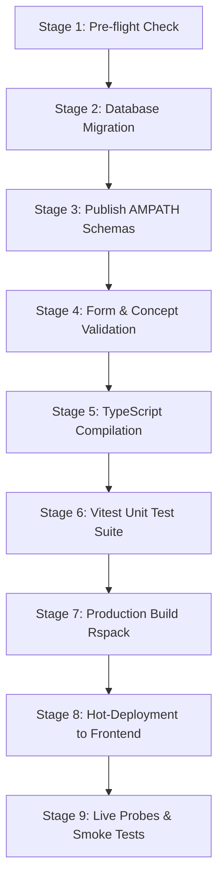

# Implementation Plan: AIIMS Clinical Intake Forms Structural Adjustments & Refactoring

**Date**: October 21, 2026  
**Document ID**: `docs/plans/2026-10-21_clinical_forms_structural_adjustments.md`  
**Status**: Pending Review & User Approval  
**Target Environment**: AIIMS OpenMRS 3.x Distribution (`@aiims/esm-demographics-app`)  

---

## Executive Summary & Scope

This plan addresses a comprehensive set of 11 clinical data modeling adjustments across 10 distinct intake forms in the AIIMS reproductive medicine and fertility suite. These adjustments correct clinical hierarchy, eliminate redundant narrative remark fields, improve data capture fidelity with structured sub-classifications (POSEIDON, TVS 3D/4D, biopsy atypia/granuloma, and ATT duration), and properly relocate couple demographic data.

| # | Domain / Form | Scope Summary | Schema File |
|:---|:---|:---|:---|
| **1** | **Demographics & Infertility Type** | Move "Married for (years)" from *Type of Infertility* to *Demographics Form* | `aiims_infertility_type.json`<br/>`aiims_personal_information.json` |
| **2** | **OVI & IUI** | (a) Remove "Previous ART Treatment Clinical Notes"<br/>(b) Separate out "Multiple OVI" check option from drug list | `aiims_prev_oi_iui.json` |
| **3** | **Previous Surgery** | Rename form & dashboards to "Previous Fertility Enhancing Surgery" | `aiims_prev_surgery.json` |
| **4** | **Previous Surgery** | Move "Hysteroscopy Dimensions (cm)" to "Operative Hysteroscopy" section | `aiims_prev_surgery.json` |
| **5** | **Female Factor** | Implement proper nested hierarchy for the POSEIDON Group | `aiims_female_factor.json` |
| **6** | **Male Hormone** | Rename "Testicular Biopsy Report / Surgical Notes" to "Testicular Biopsy Findings" | `aiims_male_hormone_surgery.json` |
| **7** | **Tuberculosis History** | Refactor "Anti-tubercular therapy (Duration)" into Year and Month dropdown selections | `aiims_tuberculosis_history.json` |
| **8** | **Procedure Embryo Transfer** | Remove "Procedure Remarks" | `aiims_procedure_embryo_transfer.json` |
| **9** | **Investigation Female TVS Ultrasound** | (a) Nest "Endometrial Cavity - Normal" into 3D and 4D<br/>(b) Rename "Septate Angle" to "Endometrial Cavity Septate Angle"<br/>(c) Rename "Length of Septum" to "Endometrial Cavity Length of Septum" | `aiims_investigation_ultrasound.json` |
| **10** | **Investigation Female Procedure Biopsy** | Make nested options for "Endometrial Hyperplasia" (with/without atypia) and "Granuloma" (Present/Absent) | `aiims_investigation_female_procedure_biopsy.json` |
| **11** | **Investigation Male Semen** | Remove "Investigation Male Semen Remarks" | `aiims_investigation_male_semen.json` |

---

## Detailed Item-by-Item Specifications

### Item 1: Move "Married for (years)" to Demographics Form

#### Rationale & Clinical Context
"Married for (years)" is a core demographic attribute characterizing the couple, originally placed in Form 2 (*Type of Infertility*). Clinically, marriage duration is collected during initial registration and patient-husband profiling rather than infertility diagnosis classification.

#### Schema Changes
1. **Source (`forms/aiims_infertility_type.json`)**:
   - Remove question `married_for_years`:
     ```json
     // REMOVE from aiims_infertility_type.json:
     {
       "label": "Married for (years)",
       "type": "obs",
       "id": "married_for_years",
       "required": "true",
       "questionOptions": {
         "rendering": "number",
         "concept": "c0010001-0000-0000-0000-000000000018",
         "min": "0",
         "max": "60"
       },
       "validators": [ ... ]
     }
     ```
   - Retain `type_of_infertility` and `duration_of_infertility`.
2. **Target (`forms/aiims_personal_information.json`)**:
   - Add `married_for_years` into Section 2 (*Patient (Wife) Demographics & Profile*) or at the start of Section 3 (*Husband Demographics & Profile*), capturing couple marriage duration with validator `0 <= myValue <= 60`.

#### Frontend & UI Changes
- `src/infertility-type/infertility-card.component.tsx`: Remove the `marriedForYears` observation row.
- `src/infertility-type/infertility-type.resource.ts`: Retain optional fallback parsing for legacy encounters, but mark as migrated.
- `src/demographics/demographics.resource.ts`: Add `marriedForYears?: string;` to `AiimsDemographicsData`, parsed via `getObsValue(CONCEPTS.marriedForYears)`.
- `src/demographics/patient-card.component.tsx`: Add row `{ label: t('marriedForYears', 'Married for'), value: demographics.marriedForYears, unit: demographics.marriedForYears ? t('years', 'years') : undefined }`.
- Update corresponding unit tests in `infertility-card.component.test.tsx` and `patient-card.component.test.tsx`.

---

### Item 2: OVI & IUI Refinements (`forms/aiims_prev_oi_iui.json`)

#### Action A: Remove "Previous ART Treatment Clinical Notes"
- Remove question `previous_art_notes` (concept `c0010001-0000-0000-0000-000000000057`).
- Update `prev-oi-iui.resource.ts` and `prev-oi-iui-card.component.tsx` to remove the notes field.

#### Action B: Separate out "Multiple OVI" from Ovulation Induction Drugs
- In `oi_drugs` (`c0010001-0000-0000-0000-000000000046`), remove answer option `c0010002-0000-0000-0000-000000000505` ("Multiple OVI"). Multiple OVI is a clinical cycle pattern, not a pharmaceutical agent (like Letrozole or hMG).
- Add a dedicated standalone question in the *Previous Ovulation Induction (OVI alone)* section:
  ```json
  {
    "label": "Multiple OVI",
    "type": "obs",
    "id": "prev_oi_multiple",
    "required": "false",
    "questionOptions": {
      "rendering": "checkbox",
      "concept": "c0010001-0000-0000-0000-000000000046",
      "answers": [
        {
          "concept": "c0010002-0000-0000-0000-000000000505",
          "label": "Multiple OVI"
        }
      ]
    },
    "hide": {
      "hideWhenExpression": "!prev_oi || prev_oi !== '1065AAAAAAAAAAAAAAAAAAAAAAAAAAAAAAAA'"
    }
  }
  ```
  *(Or register dedicated coded/boolean concept `c0010001-0000-0000-0000-000000000245` for Multiple OVI).*
- Update `prev-oi-iui.resource.ts` to extract `multipleOvi` separately from `oiDrugs`.

---

### Items 3 & 4: Previous Surgery (`forms/aiims_prev_surgery.json`)

#### Action 3: Rename to "Previous Fertility Enhancing Surgery"
- **Schema (`forms/aiims_prev_surgery.json`)**:
  - `name`: `"AIIMS Visit: Previous Fertility Enhancing Surgery"`
  - `description`: `"AIIMS Department of Reproductive Medicine & IVF - Previous Fertility Enhancing Surgery Sheet"`
  - `pages[0].label`: `"Previous Fertility Enhancing Surgery"`
- **Architecture & Routing (ADR-014 Compliance)**:
  - Keep single-SPA route path stable as `aiims-previous-surgery` to preserve URL bookmarks and SPA link contracts.
  - In `src/config/form-uuids.ts`:
    - Add/update `AIIMS_PREV_SURGERY_FORM_NAME = 'Previous Fertility Enhancing Surgery'`.
  - In `src/config/form-registry.ts`:
    - Update `title: 'Previous Fertility Enhancing Surgery'`.
  - In `translations/en.json`:
    - `"previousSurgery": "Previous Fertility Enhancing Surgery"`
    - `"previousSurgeryTitle": "Previous Fertility Enhancing Surgery"`
  - Update card title and dashboard headers.

#### Action 4: Move "Hysteroscopy Dimensions (cm)" to "Operative Hysteroscopy" Section
- Currently, `prev_hysteroscopy_dimensions` (`c0010001-0000-0000-0000-000000000120`) is placed at the end of Section 6 (*Hysteroscopy Findings*).
- Move this question into Section 7 (*Operative Hysteroscopy*) directly alongside `prev_operative_hysteroscopy` (`c0010001-0000-0000-0000-000000000121`), maintaining its conditional hide rule:
  ```json
  "hide": {
    "hideWhenExpression": "!prev_surgery || prev_surgery !== '1065AAAAAAAAAAAAAAAAAAAAAAAAAAAAAAAA'"
  }
  ```

---

### Item 5: Female Factor POSEIDON Group Nesting (`forms/aiims_female_factor.json`)

#### Clinical Context
In the AIIMS specification CSV (`005_female_fac.csv`):
```text
Diminished ovarian reserve
  Borderline Ovarian Reserve
  Patient-Oriented Strategies Encompassing IndividualizeD Oocyte Number (POSEIDON)
    POSEIDON GROUP 1
      POSEIDON GROUP 1a
      POSEIDON GROUP 1b
    POSEIDON GROUP 2
      POSEIDON GROUP 2a
      POSEIDON GROUP 2b
    POSEIDON GROUP 3
    POSEIDON GROUP 4
```

#### Schema Refactoring
1. When `female_factors` contains `c0010002-0000-0000-0000-000000000302` (*Diminished ovarian reserve*), `dor_details` is presented:
   - `Borderline Ovarian Reserve` (`c0010002-0000-0000-0000-000000000321`)
   - `Patient-Oriented Strategies Encompassing IndividualizeD Oocyte Number (POSEIDON)` (`c0010002-0000-0000-0000-000000000322`)
2. When POSEIDON is selected, present the structured POSEIDON Tier:
   - **Recommended Hierarchical Pattern**:
     - Question 1: `poseidon_group_tier` (`select` or `radio`):
       - Group 1
       - Group 2
       - Group 3 (`c0010002-0000-0000-0000-000000000327`)
       - Group 4 (`c0010002-0000-0000-0000-000000000328`)
     - Question 2 (conditional if Group 1): `poseidon_group_1_subgroup` (`radio`):
       - POSEIDON GROUP 1a (`c0010002-0000-0000-0000-000000000323`)
       - POSEIDON GROUP 1b (`c0010002-0000-0000-0000-000000000324`)
     - Question 3 (conditional if Group 2): `poseidon_group_2_subgroup` (`radio`):
       - POSEIDON GROUP 2a (`c0010002-0000-0000-0000-000000000325`)
       - POSEIDON GROUP 2b (`c0010002-0000-0000-0000-000000000326`)
   - *Alternative Clean Option*: Display labeled radio button groups cleanly grouped by tier (Group 1: 1a, 1b; Group 2: 2a, 2b; Group 3; Group 4) under a designated POSEIDON section with correct `hideWhenExpression`.
   - Update `female-factor.resource.ts` and `female-factor-card.component.tsx` to display whichever subgroup is recorded.

---

### Item 6: Male Hormone (`forms/aiims_male_hormone_surgery.json`)

#### Action
- Rename question label from `"Testicular Biopsy Report / Surgical Notes"` to `"Testicular Biopsy Findings"`.
- In `translations/en.json`:
  - Update key `"testicularBiopsy": "Testicular Biopsy Findings"`.
- In `src/male-hormone-surgery/male-hormone-surgery-card.component.tsx`:
  - Update label fallback: `t('testicularBiopsy', 'Testicular Biopsy Findings')`.
- Update `male-hormone-surgery-card.component.test.tsx` to assert `"Testicular Biopsy Findings"`.

---

### Item 7: Tuberculosis History ATT Duration (`forms/aiims_tuberculosis_history.json`)

#### Clinical Context & Refactoring
Currently, `att_duration` is a flat radio button group containing an awkward mixture of 8 labels ("6 Months", "9 Months", "1 Year", "2 Year", "3 Year", "Month", "Year", "Other duration"). In the AIIMS clinical intake workflow, clinicians record treatment duration using separate Year and Month dropdown selections.

#### Schema Implementation
Replace question `att_duration` with two distinct select questions:
1. `att_duration_years`:
   - Label: `"Anti-tubercular therapy Duration (Years)"`
   - Rendering: `"select"`
   - Concept: `c0010001-0000-0000-0000-000000000105` (or dedicated concept `c0010001-0000-0000-0000-000000000205`)
   - Answers:
     - `c0010002-0000-0000-0000-000000000823` ("1 Year")
     - `c0010002-0000-0000-0000-000000000824` ("2 Year")
     - `c0010002-0000-0000-0000-000000000825` ("3 Year")
2. `att_duration_months`:
   - Label: `"Anti-tubercular therapy Duration (Months)"`
   - Rendering: `"select"`
   - Concept: `c0010001-0000-0000-0000-000000000206` (or `c0010001-0000-0000-0000-000000000105`)
   - Answers:
     - `c0010002-0000-0000-0000-000000000821` ("6 Months")
     - `c0010002-0000-0000-0000-000000000822` ("9 Months")

#### Frontend & UI
- Update `tuberculosis-history.resource.ts` to parse `attDurationYears` and `attDurationMonths`.
- In `tuberculosis-history-card.component.tsx`: Render formatted string (e.g. `"1 Year, 6 Months"` or separate rows).
- In `ivf-summary-dashboard.component.tsx`: Support displaying the refined duration.
- Update tests in `tuberculosis-history-card.component.test.tsx`.

---

### Item 8: Procedure Embryo Transfer (`forms/aiims_procedure_embryo_transfer.json`)

#### Action
- Remove question `procedure_embryo_transfer_remarks` (concept `c0010001-0000-0000-0000-000000000182`).
- In `src/procedure-embryo-transfer/procedure-embryo-transfer-card.component.tsx`: Remove `procedureEmbryoTransferRemarks` row.
- In `translations/en.json`: Clean up unused key if no longer needed or keep for backward compatibility.
- In `src/procedure-embryo-transfer/procedure-embryo-transfer-card.component.test.tsx`: Remove assertion for `"Procedure Remarks"`.

---

### Item 9: Investigation Female TVS Ultrasound (`forms/aiims_investigation_ultrasound.json`)

#### Action A: Nest "Endometrial Cavity - Normal" into 3D and 4D
- In `tvs_endometrial_cavity` (`c0010001-0000-0000-0000-000000000134`), remove `3D` and `4D` from the primary answer list:
  ```json
  "answers": [
    { "concept": "1115AAAAAAAAAAAAAAAAAAAAAAAAAAAAAAAA", "label": "Normal" },
    { "concept": "c0010002-0000-0000-0000-000000000958", "label": "Adhesions" },
    { "concept": "c0010002-0000-0000-0000-000000000959", "label": "Fluid in cavity" }
  ]
  ```
- Add child question `tvs_endometrial_cavity_normal_type`:
  - Label: `"Endometrial Cavity Normal Evaluation"`
  - Rendering: `"radio"` or `"checkbox"`
  - Concept: `c0010001-0000-0000-0000-000000000234` (or child mapping) with answers:
    - `c0010002-0000-0000-0000-000000000956` ("3D")
    - `c0010002-0000-0000-0000-000000000957` ("4D")
  - Hide condition:
    ```json
    "hide": {
      "hideWhenExpression": "!tvs_endometrial_cavity || tvs_endometrial_cavity !== '1115AAAAAAAAAAAAAAAAAAAAAAAAAAAAAAAA'"
    }
    ```

#### Action B: Rename Septate Questions
- In `forms/aiims_investigation_ultrasound.json`:
  - `septate_angle`: Label `"Septate Angle (degrees)"` $\rightarrow$ `"Endometrial Cavity Septate Angle (degrees)"`.
  - `length_of_septum`: Label `"Length of Septum (cm)"` $\rightarrow$ `"Endometrial Cavity Length of Septum (cm)"`.
- In `translations/en.json` and `investigation-ultrasound-card.component.tsx`: Update display labels accordingly.

---

### Item 10: Investigation Female Procedure Biopsy (`forms/aiims_investigation_female_procedure_biopsy.json`)

#### Action: Nest Options for "Endometrial Hyperplasia" & "Granuloma"
1. In `eahpe_finding` (`c0010001-0000-0000-0000-000000000183`):
   - Keep `Endometrial hyperplasia` (`c0010002-0000-0000-0000-000000000986`).
   - Keep `Granuloma` (`c0010002-0000-0000-0000-000000000990`).
   - Remove flattened sub-options from this parent question:
     - Remove `Endometrial hyperplasia with atypia` (`...987`)
     - Remove `Endometrial hyperplasia without atypia` (`...988`)
     - Remove `Granuloma Present` (`...991`)
     - Remove `Granuloma Absent` (`...992`)
2. Add nested question for Endometrial Hyperplasia:
   - ID: `eahpe_hyperplasia_type`
   - Label: `"Endometrial Hyperplasia Type"`
   - Rendering: `"radio"`
   - Concept: `c0010001-0000-0000-0000-000000000283` (or coded concept)
   - Answers:
     - `c0010002-0000-0000-0000-000000000987` ("Endometrial hyperplasia with atypia")
     - `c0010002-0000-0000-0000-000000000988` ("Endometrial hyperplasia without atypia")
   - Hide condition:
     ```json
     "hide": {
       "hideWhenExpression": "!eahpe_finding || !eahpe_finding.includes('c0010002-0000-0000-0000-000000000986')"
     }
     ```
3. Add nested question for Granuloma:
   - ID: `eahpe_granuloma_status`
   - Label: `"Granuloma Findings"`
   - Rendering: `"radio"`
   - Concept: `c0010001-0000-0000-0000-000000000284` (or coded concept)
   - Answers:
     - `c0010002-0000-0000-0000-000000000991` ("Granuloma Present")
     - `c0010002-0000-0000-0000-000000000992` ("Granuloma Absent")
   - Hide condition:
     ```json
     "hide": {
       "hideWhenExpression": "!eahpe_finding || !eahpe_finding.includes('c0010002-0000-0000-0000-000000000990')"
     }
     ```
4. Frontend: Update `investigation-female-procedure-biopsy.resource.ts` and card component to display nested findings cleanly.

---

### Item 11: Investigation Male Semen (`forms/aiims_investigation_male_semen.json`)

#### Action
- Remove question `male_semen_remarks` (concept `c0010001-0000-0000-0000-000000000192`).
- In `src/investigation-male-semen/investigation-male-semen-card.component.tsx`:
  - Remove row for `male_semen_remarks`.
- In `src/investigation-male-semen/investigation-male-semen.resource.ts`:
  - Remove `investigationMaleSemenRemarks` from interface and parser.
- In `src/investigation-male-semen/investigation-male-semen-card.component.test.tsx`:
  - Remove assertions expecting Remarks text.

---

## Concept Dictionary & Database Migration Plan

If any new parent questions require registered concepts:
1. `c0010001-0000-0000-0000-000000000206`: *Anti-tubercular Therapy Duration Months* (`datatype_id = 2`, `class_id = 7`).
2. `c0010001-0000-0000-0000-000000000234`: *Endometrial Cavity Normal 3D/4D Evaluation* (`datatype_id = 2`, `class_id = 7`).
3. `c0010001-0000-0000-0000-000000000283`: *Endometrial Hyperplasia Type* (`datatype_id = 2`, `class_id = 7`).
4. `c0010001-0000-0000-0000-000000000284`: *Granuloma Finding* (`datatype_id = 2`, `class_id = 7`).
5. Update `scripts/setup_aiims_concepts.py` and execute to produce SQL migration script, then load into MariaDB container.

---

## Automated Deployment & Verification Plan

Following the workspace's 9-stage deployment gate:



1. **Schema Publishing**:
   Publish all modified schemas via:
   ```bash
   python scripts/publish_aiims_form.py --form=aiims_personal_information
   python scripts/publish_aiims_form.py --form=aiims_infertility_type
   python scripts/publish_aiims_form.py --form=aiims_prev_oi_iui
   python scripts/publish_aiims_form.py --form=aiims_prev_surgery
   python scripts/publish_aiims_form.py --form=aiims_female_factor
   python scripts/publish_aiims_form.py --form=aiims_male_hormone_surgery
   python scripts/publish_aiims_form.py --form=aiims_tuberculosis_history
   python scripts/publish_aiims_form.py --form=aiims_procedure_embryo_transfer
   python scripts/publish_aiims_form.py --form=aiims_investigation_ultrasound
   python scripts/publish_aiims_form.py --form=aiims_investigation_female_procedure_biopsy
   python scripts/publish_aiims_form.py --form=aiims_investigation_male_semen
   ```
2. **Quality Gates**:
   - `npm run validate:forms`: Validates all schemas against OpenMRS backend REST endpoints.
   - `npm run validate:concepts`: Validates all concept bindings and `concept_numeric` metadata.
   - `npm run tsc -- --noEmit`: Strict TypeScript validation under `noImplicitAny: true`.
   - `npm run test:unit`: All Vitest tests passing with updated assertions.
3. **Microfrontend Hot-Deploy**:
   - Execute `npm run deploy:local` (hot-deploys `@aiims/esm-demographics-app`).
4. **Documentation**:
   - Record completed work in `docs/records/2026-10-21/summary.md` and `PROJECT_MEMORY.md`.

---

## User Decision Points

1. **Female Factor POSEIDON Nesting**:
   - *Option A (Hierarchical 2-tier, Recommended)*: Select POSEIDON Group Tier (Group 1, Group 2, Group 3, Group 4); if Group 1 selected, show 1a vs 1b; if Group 2 selected, show 2a vs 2b.
   - *Option B (Categorized Radio Panels)*: Keep all 6 subgroups under POSEIDON, but visually group them into distinct fieldsets.
2. **Multiple OVI Placement**:
   - Keep as a distinct checkbox right under *Previous Ovulation Induction* (Yes/No).
3. **ATT Duration**:
   - Refactor into two side-by-side dropdowns: Years (1, 2, 3) and Months (6, 9).

Please confirm approval of this plan or specify any adjustments before execution begins.
