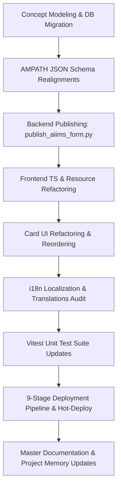

# Implementation Plan: Batch Adjustments Across 8 AIIMS IVF Clinical Forms

## Executive Summary
This plan addresses the clinical review directives across 8 AIIMS IVF intake forms:
1. **Dose of Drugs**: Align field sequence to the clinical sheet specification (`csv/aiims_03 copy - dose of drugs.csv`) and remove remarks.
2. **Adjuvant Drug**: Remove clinical remarks.
3. **Trigger Details**: Remove clinical remarks.
4. **Ovum Pick Up Details**: Reorder maturity grading from (Meta II, Meta I) to (Meta I, Meta II) and remove remarks.
5. **Procedure**: Remove remarks; prune non-surgical options (*Ejaculated, Frozen, Donor Semen, Husband Semen*) from Sperm Retrieval Procedure; add *Testicular Sperm Extraction (TESE)* and *Micro TESE (Microsurgical Testicular Sperm Extraction)*.
6. **Lab Procedure of Insemination**: Add *Frozen, DS (Donor Semen), HS (Husband Semen)* as a semen sample type question; remove remarks.
7. **Sperm Quality Assessment**: Remove remarks.
8. **Assessment of Fertilization, Embryo & Blastocyst**: Convert *Grade of Embryos Day 4* from a coded dropdown to free text; remove remarks.

---

## 1. Technical & Clinical Analysis

### 1.1 Dose of Drugs Field Sequencing
According to `csv/aiims_03 copy - dose of drugs.csv`, the required clinical order is:
1. `Total_days_of_leuprolide_downregulation` (`c0010001-...-0233`)
2. `Starting dose Follicle-Stimulating Hormone (FSH)` (`c0010001-...-0234`)
3. `Starting dose Human Menopausal Gonadotropin (HMG)` (`c0010001-...-0235`)
4. `Starting dose Recombinant Luteinizing Hormone (rLH)` (`c0010001-...-0236`)
5. `Total dose Follicle-Stimulating Hormone (FSH)` (`c0010001-...-0237`)
6. `Total dose Human Menopausal Gonadotropin (HMG)` (`c0010001-...-0238`)
7. `Total dose Recombinant Luteinizing Hormone (rLH)` (`c0010001-...-0239`)
8. `Total_Cetrotide_dose` (`c0010001-...-0240`)
9. `Day of start of Cetrotide` (`c0010001-...-0241`)
10. `Total_days_of_stimulation` (`c0010001-...-0242`)

*Key Adjustments*:
- Move `Total days of stimulation` from question #2 to the end of the form (#10).
- Group all three Starting doses together (FSH $\to$ HMG $\to$ rLH), followed by all three Total doses (FSH $\to$ HMG $\to$ rLH).
- Place `Total Cetrotide dose` before `Day of start of Cetrotide`.
- Remove `dose_of_drugs_remarks` (`c0010001-...-0243`).

---

### 1.2 Procedure Form Realignment
- **Question**: "Sperm Retrieval Procedure" (`c0010001-0000-0000-0000-000000000225`)
  - **Prune Answers**:
    - `c0010002-0000-0000-0000-000000001013` (Ejaculated)
    - `c0010002-0000-0000-0000-000000001014` (Frozen)
    - `c0010002-0000-0000-0000-000000001015` (Donor Semen)
    - `c0010002-0000-0000-0000-000000001016` (Husband Semen (HS))
  - **Retain Answers**:
    - `c0010002-0000-0000-0000-000000001011` (Percutaneous Epididymal Sperm Aspiration (PESA))
    - `c0010002-0000-0000-0000-000000001012` (Testicular Sperm Aspiration (TESA))
  - **Register New Answers**:
    - `c0010002-0000-0000-0000-000000001165`: "Testicular Sperm Extraction (TESE)" (`datatype_id=4, class_id=11`)
    - `c0010002-0000-0000-0000-000000001166`: "Micro TESE (Microsurgical Testicular Sperm Extraction)" (`datatype_id=4, class_id=11`)
- **Remarks**: Prune `procedure_remarks` (`c0010001-...-0226`).

---

### 1.3 Lab Procedure of Insemination Form Realignment
- Insemination requires knowing the sample source (Frozen, Donor, Husband).
- **Register New Question Concept**:
  - `c0010001-0000-0000-0000-000000000311`: "Semen Sample Type" (Coded, `datatype_id=2, class_id=7`).
  - **Link Answers**:
    - `c0010002-0000-0000-0000-000000001014`: "Frozen"
    - `c0010002-0000-0000-0000-000000001015`: "Donor Semen (DS)"
    - `c0010002-0000-0000-0000-000000001016`: "Husband Semen (HS)"
- **Rendering**: Checkbox (`semen_sample_type`), allowing combinations such as Frozen + Husband Semen or Frozen + Donor Semen.
- **Remarks**: Prune `lab_procedure_insemination_remarks` (`c0010001-...-0224`).

---

### 1.4 Assessment of Fertilization, Embryo & Blastocyst (Day 4 Free Text)
- Concept `c0010001-0000-0000-0000-000000000255` ("Grade of Embryos Day 4") was previously modeled as Coded (`datatype_id=2`) with restricted options (Morula, Compacted Morula, Early Blastocyst, Arrest).
- **Migration**:
  - Update `concept.datatype_id = 3` (Text) in MariaDB.
  - Delete `concept_answer` entries linking `0255` to `1070–1073`.
  - Update `forms/aiims_embryo_assessment.json`: change rendering to `"text"`.
  - Prune `embryo_assessment_remarks` (`c0010001-...-0260`).

---

### 1.5 Ovum Pick Up Details (Maturity Inversion)
- Reorder `metaphase_1` (`c0010001-...-0217`) before `metaphase_2` (`c0010001-...-0216`).
- Prune `ovum_pick_up_details_remarks` (`c0010001-...-0221`).

---

### 1.6 Systematic Remarks Removal Summary
Remarks fields to remove across 8 forms:
| Form Name | Schema File | Remarks Concept UUID |
|:---|:---|:---|
| **Dose of Drugs** | `forms/aiims_dose_of_drugs.json` | `c0010001-0000-0000-0000-000000000243` |
| **Adjuvant Drug** | `forms/aiims_adjuvant_drug.json` | `c0010001-0000-0000-0000-000000000247` |
| **Trigger Details** | `forms/aiims_trigger_details.json` | `c0010001-0000-0000-0000-000000000205` |
| **Ovum Pick Up Details** | `forms/aiims_ovum_pick_up_details.json` | `c0010001-0000-0000-0000-000000000221` |
| **Procedure** | `forms/aiims_procedure.json` | `c0010001-0000-0000-0000-000000000226` |
| **Lab Procedure Insemination** | `forms/aiims_lab_procedure_insemination.json` | `c0010001-0000-0000-0000-000000000224` |
| **Sperm Quality Assessment** | `forms/aiims_sperm_quality_assessment.json` | `c0010001-0000-0000-0000-000000000230` |
| **Embryo Assessment** | `forms/aiims_embryo_assessment.json` | `c0010001-0000-0000-0000-000000000260` |

---

## 2. Implementation Steps

### Stage 1: Concept Modeling & Database Migration
1. Update `scripts/setup_aiims_concepts.py`:
   - Add new answer concepts:
     - `c0010002-0000-0000-0000-000000001165`: "Testicular Sperm Extraction (TESE)"
     - `c0010002-0000-0000-0000-000000001166`: "Micro TESE (Microsurgical Testicular Sperm Extraction)"
   - Add new question concept:
     - `c0010001-0000-0000-0000-000000000311`: "Semen Sample Type" (`datatype_id=2, class_id=7`)
   - Change `c0010001-0000-0000-0000-000000000255` ("Grade of Embryos Day 4") to `datatype_id=3` (Text).
   - Reconfigure answer associations:
     - Associate `0225` (Sperm Retrieval) with PESA, TESA, TESE, Micro TESE.
     - Associate `0311` (Semen Sample Type) with Frozen (`1014`), Donor Semen (`1015`), Husband Semen (`1016`).
     - Remove answer loop for `0255`.
2. Generate migration SQL and execute in MariaDB container (`openmrs-distro-referenceapplication-db-1`).
3. Update `configuration/concepts/aiims/aiims_concepts.csv` and `docs/concept_registry.md`.
4. Validate with `python scripts/validate_concepts.py`.

### Stage 2: AMPATH Form Schema Updates
1. `forms/aiims_dose_of_drugs.json`:
   - Sequence: Leuprolide Downregulation $\to$ Starting FSH $\to$ Starting HMG $\to$ Starting rLH $\to$ Total FSH $\to$ Total HMG $\to$ Total rLH $\to$ Total Cetrotide dose $\to$ Day start Cetrotide $\to$ Total days stimulation.
   - Delete `dose_of_drugs_remarks`.
2. `forms/aiims_adjuvant_drug.json`:
   - Remove "Clinical Notes & Remarks" section and `adjuvant_drug_remarks`.
3. `forms/aiims_trigger_details.json`:
   - Remove `trigger_details_remarks`.
4. `forms/aiims_ovum_pick_up_details.json`:
   - Move `metaphase_1` before `metaphase_2`.
   - Remove `ovum_pick_up_details_remarks`.
5. `forms/aiims_procedure.json`:
   - Update `sperm_retrieval_procedure` options to PESA, TESA, TESE, Micro TESE.
   - Remove `procedure_remarks`.
6. `forms/aiims_lab_procedure_insemination.json`:
   - Add `semen_sample_type` checkbox question (Frozen, DS, HS).
   - Remove `lab_procedure_insemination_remarks`.
7. `forms/aiims_sperm_quality_assessment.json`:
   - Remove "Laboratory Notes & Remarks" section and `sperm_quality_assessment_remarks`.
8. `forms/aiims_embryo_assessment.json`:
   - Convert `grade_embryos_day4` rendering from `"select"` to `"text"`.
   - Remove `embryo_assessment_remarks`.

### Stage 3: Publish to Backend & Validate Schemas
1. Run `python scripts/publish_aiims_form.py` targeting all 8 modified forms:
   - `--form=Dose`
   - `--form=Adjuvant`
   - `--form=Trigger`
   - `--form=Ovum`
   - `--form=Procedure`
   - `--form=Insemination`
   - `--form=Sperm`
   - `--form=Embryo`
2. Run `python scripts/validate_forms.py` (ensure 34/34 forms pass with 0 errors).

### Stage 4: Frontend Resource & Component Refactoring
1. `src/config/concepts.ts`:
   - Add `semenSampleType: 'c0010001-0000-0000-0000-000000000311'`.
   - Add `tese: 'c0010002-0000-0000-0000-000000001165'`.
   - Add `microTese: 'c0010002-0000-0000-0000-000000001166'`.
2. Resources:
   - `src/dose-of-drugs/dose-of-drugs.resource.ts`: Prune `remarks`.
   - `src/adjuvant-drug/adjuvant-drug.resource.ts`: Prune `adjuvantDrugRemarks`.
   - `src/trigger-details/trigger-details.resource.ts`: Prune `triggerDetailsRemarks`.
   - `src/ovum-pick-up-details/ovum-pick-up-details.resource.ts`: Prune `ovumPickUpDetailsRemarks`.
   - `src/procedure/procedure.resource.ts`: Prune `procedureRemarks`.
   - `src/lab-procedure-insemination/lab-procedure-insemination.resource.ts`: Add `semenSampleType: string[]`; prune `labProcedureInseminationRemarks`.
   - `src/sperm-quality-assessment/sperm-quality-assessment.resource.ts`: Prune `remarks`.
   - `src/embryo-assessment/embryo-assessment.resource.ts`: Prune `remarks`.
3. Observation Cards:
   - `DoseOfDrugsCard`: Reorder rows to match exact clinical sheet sequence; drop remarks row.
   - `AdjuvantDrugCard`: Drop remarks row.
   - `TriggerDetailsCard`: Drop remarks row.
   - `OvumPickUpDetailsCard`: Swap Metaphase I and II rows; drop remarks row.
   - `ProcedureCard`: Drop remarks row.
   - `LabProcedureInseminationCard`: Add `semen_sample_type` row; drop remarks row.
   - `SpermQualityAssessmentCard`: Drop remarks row.
   - `EmbryoAssessmentCard`: Drop remarks row.

### Stage 5: Localization & Translations
- Update `translations/en.json`:
  - Add `semenSampleType`: "Semen Sample Type"
  - Add `donorSemenDs`: "Donor Semen (DS)"
  - Add `husbandSemenHs`: "Husband Semen (HS)"
  - Add `tese`: "Testicular Sperm Extraction (TESE)"
  - Add `microTese`: "Micro TESE (Microsurgical Testicular Sperm Extraction)"
- Run `npm run audit:i18n` (must maintain 100% health, 0 missing).

### Stage 6: Vitest Unit Test Updates
- Update test files for all 8 forms:
  - `dose-of-drugs-card.component.test.tsx` & resource tests
  - `adjuvant-drug-card.component.test.tsx` & resource tests
  - `trigger-details-card.component.test.tsx` & resource tests
  - `ovum-pick-up-details-card.component.test.tsx` & resource tests
  - `procedure-card.component.test.tsx` & resource tests
  - `lab-procedure-insemination-card.component.test.tsx` & resource tests
  - `sperm-quality-assessment-card.component.test.tsx` & resource tests
  - `embryo-assessment.test.tsx`
- Run `npm run typescript -- --noEmit` $\to$ 0 errors.
- Run `npm run test` $\to$ 102/102 tests passing.

### Stage 7: Deployment Pipeline & Verification
- Execute `npm run deploy:local` (9-stage automated deployment pipeline):
  1. Docker Pre-flight
  2. Form Validation (`validate:forms`)
  3. Concept Integrity (`validate:concepts`)
  4. TypeScript Check (`tsc --noEmit`)
  5. Vitest Unit Suite
  6. Rspack Production Build
  7. Container File Injection (`frontend-1`)
  8. Importmap Update (`openmrs-distro-referenceapplication-frontend-1`)
  9. Live Probe Verification (HTTP 200)

### Stage 8: Documentation & Record Keeping
- Create `docs/records/2026-10-22/summary.md` and `presentation_notes.md`.
- Update master ledger `docs/records/README.md`.
- Synchronize `PROJECT_MEMORY.md` with newly registered concepts and form changes.

---

## 3. Risk Assessment & Mitigations
| Risk | Severity | Mitigation |
|:---|:---:|:---|
| Changing Day 4 Grade datatype (`Coded` $\to$ `Text`) causing OpenMRS REST rejection | High | Explicitly alter MariaDB `concept.datatype_id = 3` and delete `concept_answer` entries before schema publication. |
| Missing answers in `setup_aiims_concepts.py` causing unknown concept errors | High | Register `TESE` and `Micro TESE` in both concept creation list and `sperm_retrieval_procedure` answer linkages. |
| Test regressions due to remarks row removals | Medium | Systematically update mock payloads and assertions across all 8 test suites. |
| Container offline during deployment | Medium | Pre-flight starts Docker containers via `.\openmrs.ps1 start` if stopped. |
