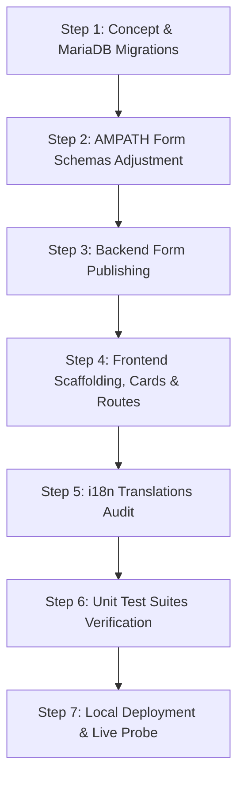

# Implementation Plan: Batch 3 Adjustments Across 6 AIIMS Clinical Forms

## Executive Summary
This implementation plan addresses the clinical adjustments across 6 AIIMS intake forms requested by the medical team:
1. **Embryo Grading Day 3**: Remove redundant `"Embryos (Day 3)"` from field names (simplifying to `"Grade 1"`, `"Grade 2"`, `"Grade 3"`, `"Grade 4"`).
2. **Embryos Frozen**: Deprecate clinical remarks in accordance with ADR-017.
3. **Fresh Embryo Transfer Details**: Deprecate clinical remarks in accordance with ADR-017.
4. **Additional Procedures in Assisted Reproductive Technology**: Realize full title expansion from `"Additional Procedures in ART"` to `"Additional Procedures in Assisted Reproductive Technology"` across form registry, Single-SPA routing, AMPATH form schema, frontend card, dashboard, and i18n translations.
5. **Post-InVitro Fertilisation Investigation**: Prune answer option `"Inconclusive"` from `"Urine Pregnancy Test (UPT)"` (concept `c0010001-0000-0000-0000-000000000294`), restricting options to `"Positive"` and `"Negative"`.
6. **Examination Infant**:
   - Merge all sections into a unified single-section layout under ADR-014.
   - Convert `"Sex of Baby"` (`c0010001-0000-0000-0000-000000000302`) from Coded (`datatype_id=2`) to free text (`datatype_id=3`), executing automated historical `obs` migration under ADR-019.

---

## 1. Technical & Clinical Analysis by Form

### 1.1 Embryo Grading Day 3 (`forms/aiims_embryo_grading_day3.json`)
- **Current State**:
  Field labels are verbose and repeat the form context:
  - `"Grade 1 Embryos (Day 3)"` (`c0010001-...-0268`)
  - `"Grade 2 Embryos (Day 3)"` (`c0010001-...-0269`)
  - `"Grade 3 Embryos (Day 3)"` (`c0010001-...-0270`)
  - `"Grade 4 Embryos (Day 3)"` (`c0010001-...-0271`)
- **Required Action**:
  - Update AMPATH JSON schema question labels to:
    - `"Grade 1"`
    - `"Grade 2"`
    - `"Grade 3"`
    - `"Grade 4"`
  - Update `src/embryo-grading-day3/embryo-grading-day3-card.component.tsx` to use simplified fallback strings and keys.
  - Update `translations/en.json` values for `grade1EmbryosDay3` through `grade4EmbryosDay3`.
  - Update unit test assertions in `src/embryo-grading-day3/embryo-grading-day3.test.tsx`.
  - Republish form via `python scripts/publish_aiims_form.py --form=aiims_embryo_grading_day3`.

---

### 1.2 Embryos Frozen (`forms/aiims_embryos_frozen.json`)
- **Current State**:
  Contains question `embryos_frozen_remarks` (`c0010001-0000-0000-0000-000000000279`).
- **Required Action**:
  - Remove question `embryos_frozen_remarks` from `forms/aiims_embryos_frozen.json`.
  - Prune `embryosFrozenRemarks` from `AiimsEmbryosFrozenData` interface and extraction in `src/embryos-frozen/embryos-frozen.resource.ts`.
  - Prune `remarksRows` and remarks rendering from `src/embryos-frozen/embryos-frozen-card.component.tsx`.
  - Update `src/embryos-frozen/embryos-frozen.test.tsx` to remove remarks mock data and assertions.
  - Republish form via `python scripts/publish_aiims_form.py --form=aiims_embryos_frozen`.

---

### 1.3 Fresh Embryo Transfer Details (`forms/aiims_fresh_et_details.json`)
- **Current State**:
  Contains question `fresh_et_remarks` (`c0010001-0000-0000-0000-000000000290`).
- **Required Action**:
  - Remove question `fresh_et_remarks` from `forms/aiims_fresh_et_details.json`.
  - Prune `freshEtRemarks` from `AiimsFreshEtDetailsData` interface and extraction in `src/fresh-et-details/fresh-et-details.resource.ts`.
  - Prune `freshEtRemarks` from `src/fresh-et-details/fresh-et-details-card.component.tsx`.
  - Update unit tests in `src/fresh-et-details/fresh-et-details.test.tsx` (pruning assertion on line 70).
  - Republish form via `python scripts/publish_aiims_form.py --form=aiims_fresh_et_details`.

---

### 1.4 Additional Procedures in Assisted Reproductive Technology (`forms/aiims_add_procedure_art.json`)
- **Current State**:
  The MariaDB form name is already `"AIIMS Visit: Additional Procedures in Assisted Reproductive Technology"`, but the frontend and form schema retain the abbreviated title:
  - `src/config/form-registry.ts`: `title: 'Additional Procedures in ART'`
  - `forms/aiims_add_procedure_art.json`: Page, section, and question labels say `"Additional Procedures in ART"`
  - `translations/en.json`: Keys refer to `"Additional Procedures in ART"`
- **Required Action**:
  - In `src/config/form-registry.ts`: Update `title` to `'Additional Procedures in Assisted Reproductive Technology'`.
  - Regenerate Single-SPA routes: `npm run generate-routes` (updates `src/routes.json` navigation title).
  - In `forms/aiims_add_procedure_art.json`:
    - Page label: `"Additional Procedures in Assisted Reproductive Technology"`
    - Section label: `"Additional Procedures in Assisted Reproductive Technology"`
    - Question label: `"Additional Procedures in Assisted Reproductive Technology"`
  - In `src/add-procedure-art/add-procedure-art-card.component.tsx` & `add-procedure-art-dashboard.component.tsx`: Update card headers and translation calls.
  - In `translations/en.json`: Update user-facing strings to the full title.
  - In `src/add-procedure-art/add-procedure-art.test.tsx`: Align title assertions.
  - Republish form via `python scripts/publish_aiims_form.py --form=aiims_add_procedure_art`.

---

### 1.5 Post-InVitro Fertilisation Investigation (`forms/aiims_post_ivf_investigation.json`)
- **Current State**:
  Question `"Urine Pregnancy Test (UPT)"` (`c0010001-0000-0000-0000-000000000294`) has three coded answers:
  1. `c0010002-0000-0000-0000-000000001136` (Positive)
  2. `c0010002-0000-0000-0000-000000001137` (Negative)
  3. `c0010002-0000-0000-0000-000000001138` (Inconclusive)
- **Required Action**:
  - In `forms/aiims_post_ivf_investigation.json`: Remove answer object `c0010002-...-1138` (Inconclusive) from `uptResult`.
  - In `scripts/setup_aiims_concepts.py`:
    - Remove `("c0010002-0000-0000-0000-000000001138", "Inconclusive")` from `upt_result_answers`.
    - Add database migration to remove `concept_answer` link for 1138 from concept 0294.
  - In `docs/concept_registry.md`: Update UPT answers table.
  - Republish form via `python scripts/publish_aiims_form.py --form=aiims_post_ivf_investigation`.

---

### 1.6 Examination Infant (`forms/aiims_examination_infant.json`)
- **Current State**:
  - Schema contains two separate sections: `"Neonatal Anthropometry"` and `"Physical Assessment & Vitality"`.
  - `"Sex of Baby"` (`c0010001-0000-0000-0000-000000000302`) is Coded (`datatype_id=2`) with radio options: Male, Female, Ambiguous.
  - MariaDB currently contains an active observation: `obs_id=6426` with `value_coded=5002` (Male) and `value_text=NULL`.
- **Required Action**:
  - **Remove Form Sections (ADR-014)**:
    - Collapse into a single section labeled `"Examination Infant"` with `questions: [sexOfBaby, weightOfBaby, apgarScore]`.
  - **Make "Sex of Baby" Free Text (ADR-019)**:
    - Update schema rendering: `"rendering": "text"` and remove `answers` array.
    - Update concept in `scripts/setup_aiims_concepts.py`: set `datatype_id=3` (Text) for `c0010001-0000-0000-0000-000000000302`.
    - Add automated database migration in `scripts/setup_aiims_concepts.py`:
      ```sql
      UPDATE concept SET datatype_id = 3 WHERE uuid = 'c0010001-0000-0000-0000-000000000302';
      DELETE FROM concept_answer WHERE concept_id = (SELECT concept_id FROM concept WHERE uuid = 'c0010001-0000-0000-0000-000000000302');
      UPDATE obs o
      JOIN concept_name cn ON o.value_coded = cn.concept_id AND cn.locale = 'en' AND cn.concept_name_type = 'FULLY_SPECIFIED'
      SET o.value_text = cn.name, o.value_coded = NULL
      WHERE o.concept_id = (SELECT concept_id FROM concept WHERE uuid = 'c0010001-0000-0000-0000-000000000302');
      ```
  - In `src/examination-infant/`:
    - `examination-infant-card.component.tsx` already handles arbitrary strings gracefully.
    - Confirm tests pass and verify rendering.
  - Republish form via `python scripts/publish_aiims_form.py --form=aiims_examination_infant`.

---

## 2. Implementation Steps & Sequencing



### Step 1: Database & Concept Setup
1. Update `scripts/setup_aiims_concepts.py`:
   - Change `c0010001-0000-0000-0000-000000000302` ("Sex of Baby") to `datatype_id=3`.
   - Remove `"Inconclusive"` from `upt_result_answers`.
   - Add DB migration SQL for both concept answer cleanup and `obs` text conversion.
2. Execute `python scripts/setup_aiims_concepts.py`.
3. Verify with `python scripts/validate_concepts.py`.

### Step 2: Form Schema Modifications
1. Modify `forms/aiims_embryo_grading_day3.json` (simplify Grade 1–4 field labels).
2. Modify `forms/aiims_embryos_frozen.json` (prune remarks question).
3. Modify `forms/aiims_fresh_et_details.json` (prune remarks question).
4. Modify `forms/aiims_add_procedure_art.json` (update title and labels to full text).
5. Modify `forms/aiims_post_ivf_investigation.json` (remove "Inconclusive" answer).
6. Modify `forms/aiims_examination_infant.json` (flatten to 1 section, change `sexOfBaby` to text).
7. Validate schemas with `python scripts/validate_forms.py`.

### Step 3: Backend Form Publishing
1. Run `python scripts/publish_aiims_form.py --form=aiims_embryo_grading_day3`.
2. Run `python scripts/publish_aiims_form.py --form=aiims_embryos_frozen`.
3. Run `python scripts/publish_aiims_form.py --form=aiims_fresh_et_details`.
4. Run `python scripts/publish_aiims_form.py --form=aiims_add_procedure_art`.
5. Run `python scripts/publish_aiims_form.py --form=aiims_post_ivf_investigation`.
6. Run `python scripts/publish_aiims_form.py --form=aiims_examination_infant`.
7. Re-run `python scripts/validate_forms.py` (ensure 35/35 forms valid).

### Step 4: Frontend Module Updates & Routing
1. Update `src/config/form-registry.ts` with the new title for Form 32.
2. Run `npm run generate-routes` to synchronize `src/routes.json` and `src/generated-form-extensions.ts`.
3. Update resource extraction interfaces and hooks:
   - `src/embryos-frozen/embryos-frozen.resource.ts`
   - `src/fresh-et-details/fresh-et-details.resource.ts`
4. Update ObservationCards and Dashboards:
   - `src/embryo-grading-day3/embryo-grading-day3-card.component.tsx`
   - `src/embryos-frozen/embryos-frozen-card.component.tsx`
   - `src/fresh-et-details/fresh-et-details-card.component.tsx`
   - `src/add-procedure-art/add-procedure-art-card.component.tsx`
   - `src/add-procedure-art/add-procedure-art-dashboard.component.tsx`
5. Update unit test suites:
   - `src/embryo-grading-day3/embryo-grading-day3.test.tsx`
   - `src/embryos-frozen/embryos-frozen.test.tsx`
   - `src/fresh-et-details/fresh-et-details.test.tsx`
   - `src/add-procedure-art/add-procedure-art.test.tsx`
   - `src/examination-infant/examination-infant.test.tsx`

### Step 5: Translations Synchronization
1. Synchronize `translations/en.json`:
   - Grade 1–4 keys.
   - Additional Procedures in Assisted Reproductive Technology keys.
2. Run `npm run audit:i18n` (must report 0 missing keys).

### Step 6: Test Suite & Type Checking
1. Run `npm run type-check` (`tsc --noEmit`) to verify `noImplicitAny: true`.
2. Run `npm test` (`vitest`) across all test suites (expect 105+ passing tests).

### Step 7: Hot-Deployment & Verification
1. Run `npm run deploy:local` (executes 7-stage automated deployment pipeline).
2. Verify live bundle endpoint `http://localhost/openmrs/spa/importmap.json`.
3. Update documentation in `docs/concept_registry.md`, `docs/records/2026-10-22/`, and `PROJECT_MEMORY.md`.

---

## 3. Risk Assessment & Mitigation

| Potential Risk | Root Cause | Preventive Mitigation |
| :--- | :--- | :--- |
| **UUID / Coded Display Bug on "Sex of Baby"** | Historical observation in `obs` table has `value_coded=5002` while concept is migrated to Text (`datatype_id=3`). | Proactive MariaDB SQL migration joining `concept_name` to set `value_text = 'Male'` and `value_coded = NULL` before opening form in Form Engine. |
| **Broken Vitest Tests** | Outdated string assertions matching old form titles, labels, or pruned remarks. | Update mock objects and assertions in test files in lockstep with component changes. |
| **Single-SPA Link Mismatch** | Editing `routes.json` manually rather than regenerating via single source of truth. | Strictly run `npm run generate-routes` after updating `form-registry.ts`. |
| **Concept Answer Discrepancy** | `c0010002-...-1138` remaining linked as an answer to `c0010001-...-0294` in DB despite schema removal. | Explicitly remove `concept_answer` row in MariaDB via SQL procedure. |
