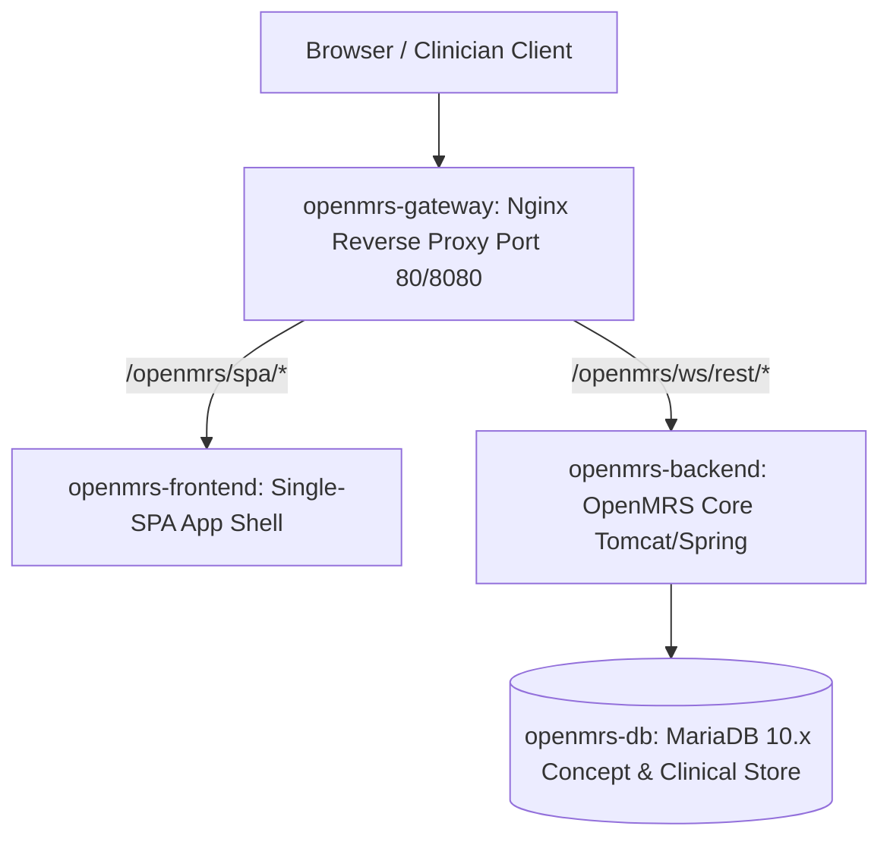

# Presentation Notes: 2026-09-18
## Topic: Repository Setup, Container Architecture & Environment Orchestration

---

### Slide 1: Executive Summary & Milestone Achievement
* **Core Achievements**:
  - Initialized Git repository structure with comprehensive `.gitignore` and line ending rules.
  - Configured multi-container microservices architecture via Docker Compose (`gateway`, `frontend`, `backend`, `db`).
  - Authored the `openmrs.ps1` PowerShell automation tool for local container operations.
* **Clinical Significance**: Establishes a reproducible, enterprise-grade local infrastructure for building, testing, and verifying the AIIMS OpenMRS 3.x fertility platform.

---

### Slide 2: Multi-Container Microservices Topology

#### Architecture Components:
1. **Gateway**: Nginx reverse proxy unifying Single-SPA static assets and REST API calls under a single origin.
2. **Frontend Shell**: OpenMRS 3.x microfrontend host supporting dynamic runtime module injection.
3. **Backend Server**: Core Java Spring application providing FHIR and REST services.
4. **Relational Database**: MariaDB hosting the complete concept dictionary and clinical observations.

---

### Slide 3: Engineering Decisions & Post-Mortem

#### The Problems Solved:
1. **Environment Discrepancies**:
   - Containerized all platform dependencies into Docker Compose, eliminating host software version conflicts.
2. **Cross-Platform Developer Friction**:
   - Created `openmrs.ps1` providing streamlined PowerShell commands for Windows development workstations.
3. **Port Conflicts**:
   - Configured flexible gateway port mapping to accommodate varied local host environments.

---

### Slide 4: Key Platform Metrics

| Metric | Day 0 Milestone |
|---|---|
| **Stack Architecture** | Multi-Container Docker Compose (4 services) |
| **Container Health** | Gateway, Frontend, Backend, MariaDB active |
| **Developer CLI** | `openmrs.ps1` operational |
| **Git Commits Executed** | **3 commits** |

---

### Slide 5: Standup Talking Points for PI
1. **Full Stack Containerized**: Successfully orchestrated OpenMRS 3.x frontend, backend, and MariaDB containers under Docker Compose.
2. **One-Command Container Control**: Built `openmrs.ps1` to start, stop, restart, and inspect the platform with zero friction.
3. **Ready for Clinical Development**: With a healthy local environment, development of the AIIMS custom fertility microfrontend can begin immediately.
