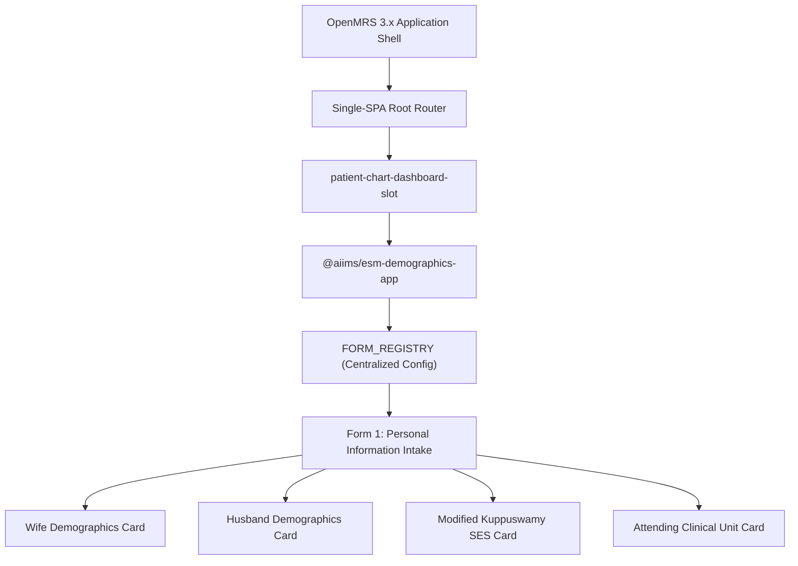

# Presentation Notes: 2026-09-27
## Topic: Microfrontend Bootstrap, Personal Information Intake & Architecture Foundations

---

### Slide 1: Executive Summary & Milestone Achievement
* **Core Achievements**:
  - Bootstrapped `@aiims/esm-demographics-app` as an OpenMRS 3.x Single-SPA React microfrontend.
  - Implemented and published Form 1 (*Personal Information Intake*) with couple demographics and the Modified Kuppuswamy Socioeconomic Scale.
  - Established configuration-driven development via `FORM_REGISTRY` and created shared UI primitives.
  - Authored foundational `PROJECT_MEMORY.md` workspace guidelines.
* **Clinical Significance**: Replaces paper registration with structured couple-level baseline intake, including socioeconomic grading and attending clinical team assignment.

---

### Slide 2: Microfrontend Architecture & Form 1

#### What Was Delivered:
1. **Couple-Centric Demographics**: Pinned identification, age, and contact information for both partners.
2. **Socioeconomic Stratification**: Automated calculation and categorization of Kuppuswamy socioeconomic classes (Class I to V).
3. **Seamless OpenMRS Integration**: Embedded directly inside standard patient chart navigation using Carbon Design System.

---

### Slide 3: Engineering Decisions & Post-Mortem

#### The Problems Solved:
1. **Monolithic vs Modular Microfrontend**:
   - Chose Single-SPA microfrontend architecture over traditional Java OMOD modules to enable instant hot-deployments without server restarts.
2. **Configuration vs Boilerplate**:
   - Centralized extension mapping in `FORM_REGISTRY` to allow scaling to 30+ forms with minimal code duplication.
3. **Aesthetic Consistency**:
   - Fixed sidebar menu styling mismatches by adhering strictly to Carbon CSS custom properties.

---

### Slide 4: Key Platform Metrics

| Metric | Day 1 Milestone |
|---|---|
| **Microfrontend Architecture** | OpenMRS 3.x Single-SPA (Rspack + React 18) |
| **Published Clinical Forms** | **1 form active (Personal Information)** |
| **Active Medical Concepts** | **31 concepts in MariaDB** |
| **Design System** | Carbon Design System (`@carbon/react`) |
| **Git Commits Executed** | **3 commits** |

---

### Slide 5: Standup Talking Points for PI
1. **Microfrontend Live**: Successfully deployed `@aiims/esm-demographics-app` into OpenMRS 3.x with zero server restarts.
2. **Form 1 Operational**: Delivered couple demographics and Modified Kuppuswamy socioeconomic status intake.
3. **Scalable Architecture**: Built `FORM_REGISTRY` configuration pattern and shared component library to power all subsequent clinical forms.
