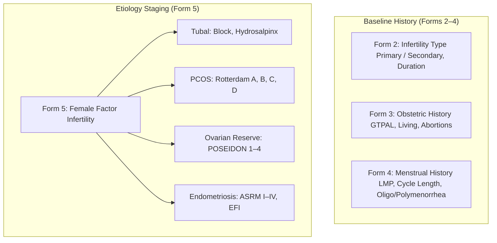

# Presentation Notes: 2026-09-28
## Topic: Baseline Intake, Female Etiology Factors & Docker Infrastructure Hardening (Forms 2–5)

---

### Slide 1: Executive Summary & Milestone Achievement
* **Core Achievements**:
  - Implemented and published **Forms 2, 3, 4, and 5**: Form 2 (*Type of Infertility*), Form 3 (*Obstetric History*), Form 4 (*Menstrual History*), and Form 5 (*Female Factor Infertility*).
  - Solved OpenMRS REST encounter query limitations with deterministic client-side filtering.
  - Hardened Docker volume security and resolved non-root UID 1001 file ownership conflicts.
  - Implemented multi-level skip logic capturing international reproductive staging (POSEIDON, Rotterdam, ASRM).
* **Clinical Significance**: Replaces paper intake files with structured digital baseline records for female reproductive history and gynecological pathology.

---

### Slide 2: Intake & Female Factor Architecture

#### What Clinicians Experience:
1. **At-a-Glance GTPAL & Menstrual History**: Instant visibility into gravidity, parity, previous pregnancy outcomes, and cycle characteristics.
2. **Standardized Clinical Staging**: Structured capture of POSEIDON criteria and Rotterdam phenotypes rather than ambiguous free text.
3. **Responsive Conditional Logic**: Complex sub-questions render smoothly based on clinician selections.

---

### Slide 3: Engineering Decisions & Post-Mortem

#### The Problems Solved:
1. **Silent REST Query Defect**:
   - Filtered encounters client-side by `form.uuid` and sorted descending by `encounterDatetime` to prevent showing wrong form data.
2. **Container UID 1001 Startup Failures**:
   - Established strict ownership remediation (`chown -R 1001:root`) for mounted persistent storage.
3. **Cache Invalidation Automation**:
   - Built auto-versioned deployment scripts to ensure browser Single-SPA clients instantly load new bundles.

---

### Slide 4: Key Platform Metrics

| Metric | Before Sprint | After Sprint |
|---|---|---|
| **Active Clinical Forms** | 1 form | **5 forms active** |
| **Concept Registry** | 31 concepts | **76 unique concepts** |
| **REST Encounter Integrity** | Flaky (unfiltered queries) | **100% Client-Side Filtered & Sorted** |
| **Git Commits Executed** | — | **7 commits** |

---

### Slide 5: Standup Talking Points for PI
1. **Forms 2 through 5 Delivered**: Completed foundational intake modules including Infertility Type, Obstetric GTPAL, Menstrual, and Female Factor.
2. **International Staging Standards**: Embedded POSEIDON criteria for ovarian reserve, Rotterdam criteria for PCOS, and ASRM staging for endometriosis.
3. **Core Stability Secured**: Bypassed OpenMRS REST encounter query limitations and resolved container UID 1001 permission issues.
