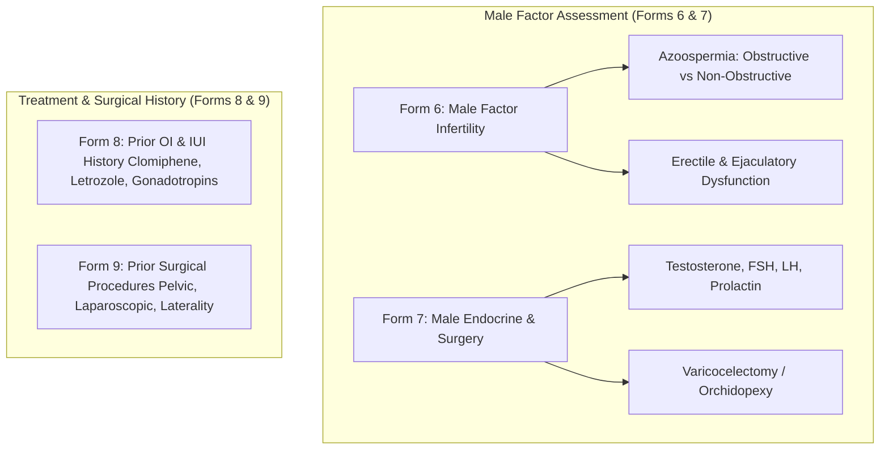

# Presentation Notes: 2026-09-29
## Topic: Male Factor Diagnostics, Surgical History & Reusable Dashboard Architecture (Forms 6–9)

---

### Slide 1: Executive Summary & Milestone Achievement
* **Core Achievements**:
  - Implemented and published **Forms 6, 7, 8, and 9**: Form 6 (*Male Factor Infertility*), Form 7 (*Male Hormone & Surgery*), Form 8 (*Previous OI & IUI*), and Form 9 (*Previous Surgery*).
  - Architected the reusable `FormDashboardShell` component, eliminating ~400 lines of duplicate UI layout code.
  - Resolved observation sorting race conditions and fixed medical unit HTML entity escaping.
* **Clinical Significance**: Provides complete male reproductive evaluation (hormones, surgical history, and azoospermia subtyping) alongside female prior treatment records.

---

### Slide 2: Clinical Data Flow: Male Evaluation & Prior Interventions

#### What Clinicians Experience:
1. **At-a-Glance Male Pathology**: Clear flags for obstructive vs non-obstructive azoospermia directing surgical sperm retrieval planning.
2. **Standardized Clinical Chrome**: Every dashboard features identical Carbon Design System layouts, loading skeletons, and edit triggers via `FormDashboardShell`.
3. **Pristine Medical Typography**: Standardized units (`ng/dL`, `mIU/mL`, `kg/m²`) render cleanly without HTML escaping errors.

---

### Slide 3: Engineering Decisions & Post-Mortem

#### The Problems Solved:
1. **Frontend Code Duplication**:
   - Consolidated repetitive dashboard headers, buttons, loading skeletons, and empty states into `FormDashboardShell`.
2. **Observation Timestamp Collision**:
   - Enforced primary timestamp sort with secondary UUID tie-breaker to prevent UI jitter.
3. **Translation Unit Escaping**:
   - Disabled HTML character entity escaping for interpolated medical units in translation keys.

---

### Slide 4: Key Platform Metrics

| Metric | Before Sprint | After Sprint |
|---|---|---|
| **Active Clinical Forms** | 5 forms | **9 forms active** |
| **Boilerplate Reduction** | 100+ lines per dashboard | **Centralized `FormDashboardShell`** |
| **Observation Sort Stability** | Non-deterministic | **100% Deterministic (Timestamp + UUID)** |
| **Git Commits Executed** | — | **6 commits** |

---

### Slide 5: Standup Talking Points for PI
1. **Forms 6 through 9 Live**: Completed male diagnostic evaluation (etiologies, hormones, surgeries) and historical treatment records (OI, IUI, prior surgery).
2. **Architecture Refactoring**: Delivered `FormDashboardShell`, removing 400+ lines of duplicate layout boilerplate across the frontend.
3. **Data Display Precision**: Eliminated observation rendering race conditions and cleaned up clinical unit typography.
