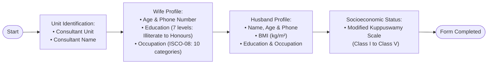
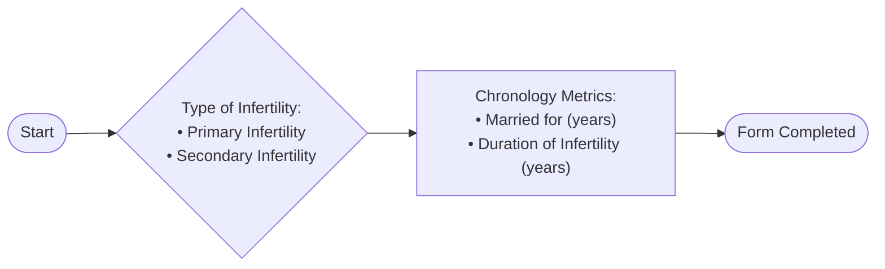
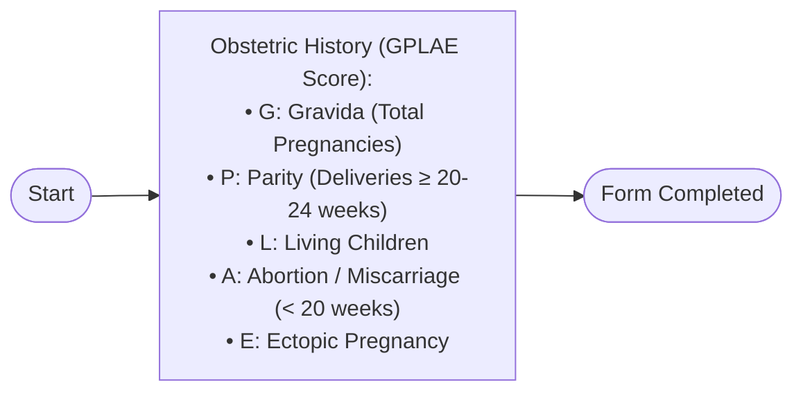
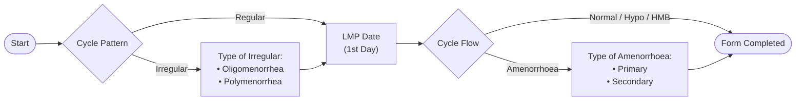
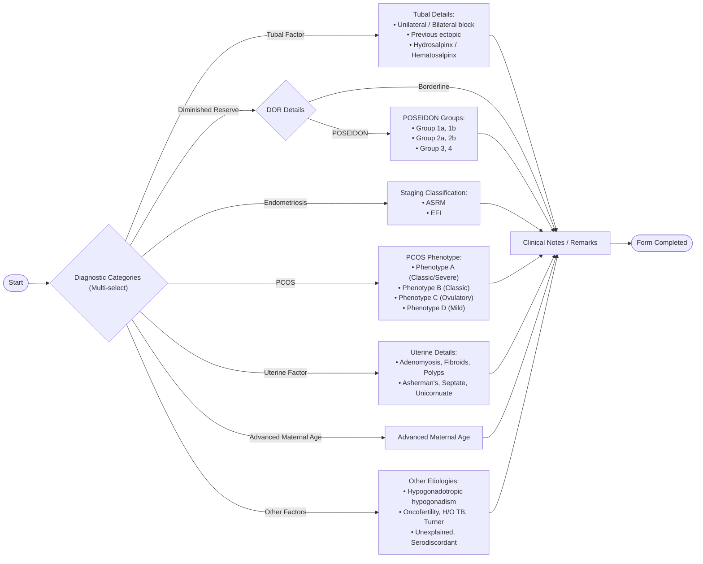
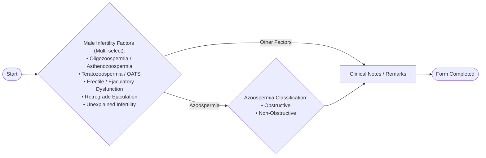
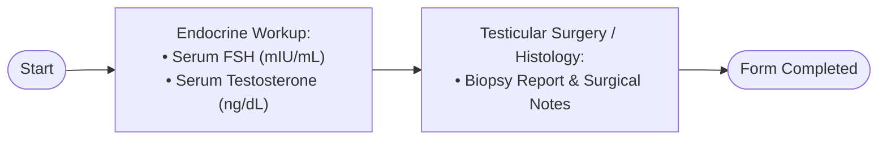
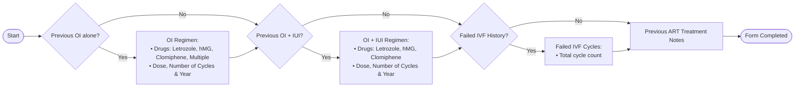
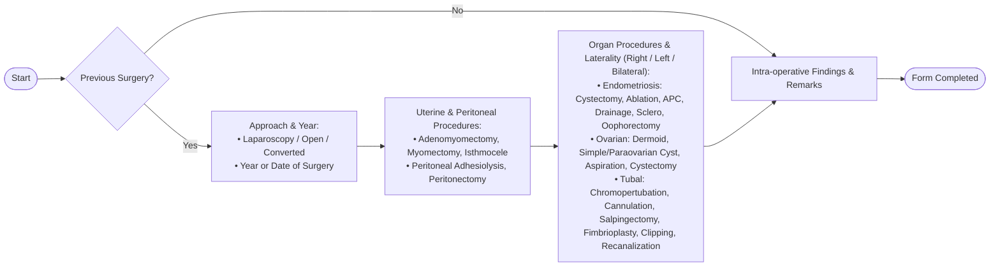

Created aiims_forms_presentation_outline.md

Here are the consolidated, uncluttered horizontal flowcharts (`flowchart LR`) for each of the 9 clinical forms. These are streamlined for executive slides and presentation directly to your PI, and saved at:
👉 **[aiims_forms_presentation_outline.md](file:///C:/Users/Ayanshu/.gemini/antigravity-ide/brain/3667440e-419b-4aa3-a2f8-225c59a2395c/aiims_forms_presentation_outline.md)**

---

### Slide 1: Personal Information Intake

---

### Slide 2: Type of Infertility & Chronology

---

### Slide 3: Obstetric History (GPLAE)

---

### Slide 4: Menstrual History

---

### Slide 5: Female Factor Infertility

---

### Slide 6: Male Factor Infertility

---

### Slide 7: Male Hormone & Surgery

---

### Slide 8: Previous OI, IUI & IVF

---

### Slide 9: Previous Surgery
