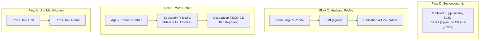
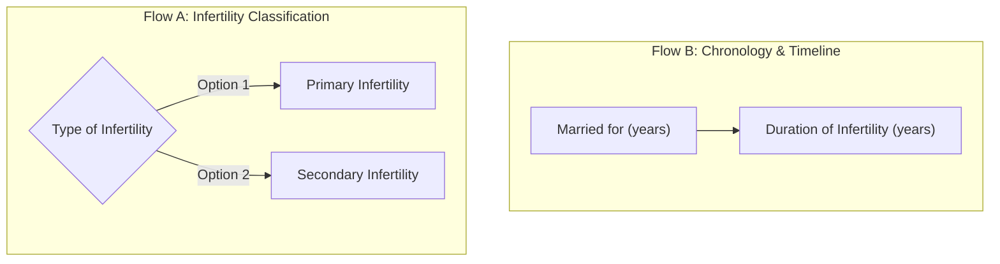
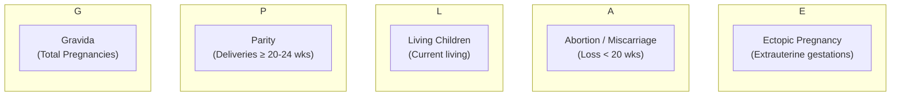
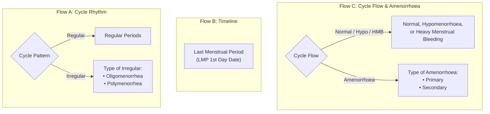
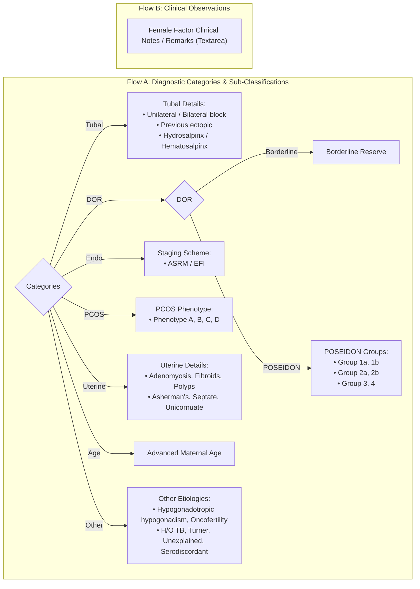
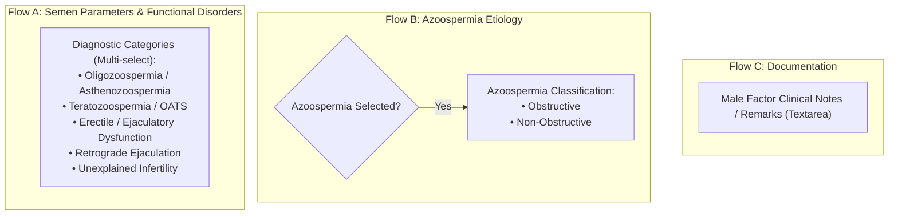
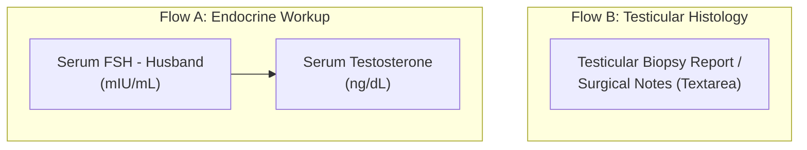
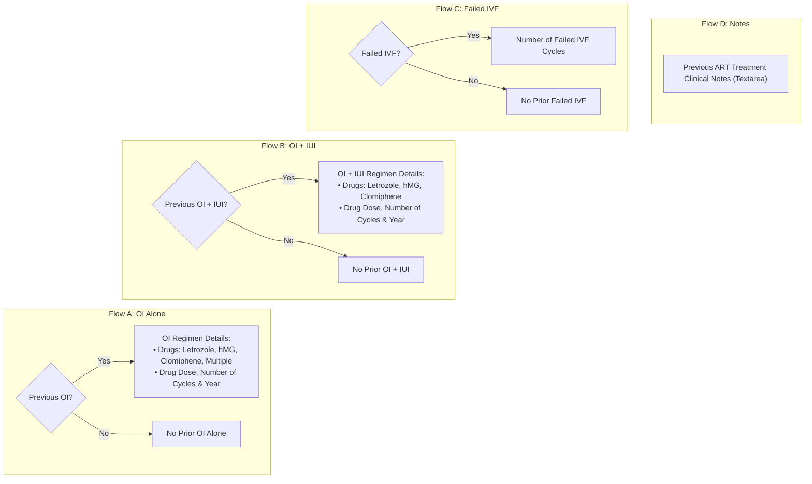
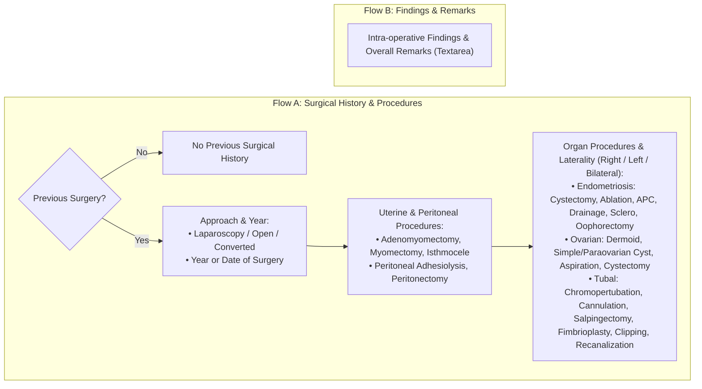

# AIIMS Clinical Forms: Strictly Horizontal Multi-Flow Slide Deck

---

## Slide 1: Personal Information Intake

---

## Slide 2: Type of Infertility & Chronology

---

## Slide 3: Obstetric History (GPLAE Score)

---

## Slide 4: Menstrual History

---

## Slide 5: Female Factor Infertility

---

## Slide 6: Male Factor Infertility

---

## Slide 7: Male Hormone & Surgery

---

## Slide 8: Previous OI, IUI & IVF

---

## Slide 9: Previous Surgery

