# Presentation Notes: 2026-10-02
## Topic: Clinical Decision Architecture & Flowchart Modeling (Forms 1–9)

---

### Slide 1: Executive Summary & Milestone Achievement
* **Core Achievements**:
  - Synthesized comprehensive clinical decision and skip-logic flowcharts for the initial **9 clinical intake forms** (Forms 1 through 9).
  - Delivered two distinct presentation models:
    1. **Consolidated Overview Deck** (`Form Flowchart Consolidated Options.md`): Streamlined horizontal flowcharts (`LR`) designed for executive briefings.
    2. **Strictly Horizontal Multi-Flow Subgraph Deck** (`Form Flowchart Separate flow.md`): Isolated parallel clinical assessment streams utilizing invisible rank bindings (`~~~`).
  - Formulated the architectural blueprint for the persistent **Patient Demographics Summary Widget** (`implementation_plan_demographics_summary_widget.md`) to replace default vitals in the patient chart header.
* **Clinical Significance**: Provides transparent, visual mapping of reproductive medicine taxonomies (POSEIDON DOR criteria, Rotterdam PCOS phenotypes, ASRM/EFI staging, WHO semen parameters, and surgical laterality), ensuring clinical alignment before scaling to remaining specialty forms.

---

### Slide 2: Clinical Intake Decision Pipeline (Forms 1–9)

```mermaid
flowchart LR
    subgraph Intake_Phase["Phase 1: Baseline Demographics & History"]
        F1["Form 1: Personal Intake<br/>(Wife, Husband, SES)"]
        F2["Form 2: Infertility Type<br/>(Primary / Secondary, Years)"]
        F3["Form 3: Obstetric History<br/>(GPLAE Score 5-factor Strip)"]
        F4["Form 4: Menstrual History<br/>(Rhythm, LMP, Flow/Amenorrhoea)"]
        F1 --> F2 --> F3 --> F4
    end

    subgraph Diagnostic_Phase["Phase 2: Etiological Categorization"]
        F5["Form 5: Female Factor<br/>(Tubal, DOR/POSEIDON, Endo, PCOS)"]
        F6["Form 6: Male Factor<br/>(WHO Semen, Azoospermia OA/NOA)"]
        F7["Form 7: Male Hormone & Surgery<br/>(FSH, Testosterone, Biopsy)"]
        F4 --> F5
        F5 --> F6 --> F7
    end

    subgraph Historical_Procedures["Phase 3: Prior Interventions"]
        F8["Form 8: Previous OI / IUI / IVF<br/>(Cycles, Drugs, Year)"]
        F9["Form 9: Previous Surgery<br/>(Laparoscopy, Organ Laterality)"]
        F7 --> F8 --> F9
    end

    F9 --> Ready([Ready for Specialty Diagnostic Forms])
```

#### What Clinicians Experience:
1. **Unambiguous Decision Paths**: Clear distinction between primary diagnostic categories and detailed conditional scoring systems.
2. **Standardized Reproductive Taxonomies**: Embedded compliance with international fertility guidelines (Rotterdam, POSEIDON, ASRM, WHO 6th edition).
3. **Structured Surgical Recording**: Complete laterality mapping across pelvic organs avoiding unstructured clinical prose.

---

### Slide 3: Engineering Architecture & Visual Ergonomics

#### Architectural Decisions:
1. **Strictly Horizontal Orientation (`flowchart LR`)**:
   - Maximizes 16:9 widescreen presentation display on clinical review monitors.
   - Eliminates vertical scrolling friction present in top-down (`TD`) graphs.
2. **Invisible Tilde Constraints (`NodeA ~~~ NodeB`)**:
   - Enforces parallel subgraph ranking without creating spurious directional dependencies.
   - Preserves independent clinical data streams (e.g. Wife vs Husband profiles; GPLAE 5-factor strip).
3. **Dual Presentation Strategy**:
   - *Consolidated Options*: Designed for executive summary slides and high-level stakeholder reviews.
   - *Separate Flow*: Designed for granular intake training and technical form authoring reference.
4. **Patient Header Widget Architecture**:
   - Planned the persistent couple demographics header bar mounted into `patient-chart-summary-dashboard-slot` with one-click full navigation.

---

### Slide 4: Key Platform & Modeling Metrics

| Metric | Achievement / Status |
|---|---|
| **Modeled Clinical Forms** | **9 of 9 Forms Fully Flowcharted** |
| **Specialized Taxonomies Mapped** | POSEIDON (1a–4), Rotterdam (A–D), ASRM/EFI, WHO Semen |
| **Flowchart Decks Produced** | **2 Slide Decks (18 Total Diagrams)** |
| **Active Concepts Represented** | **237 Verified Relational Concepts** |
| **Header Architecture Plans** | **1 Implementation Plan (`demographics-summary-widget`)** |

---

### Slide 5: Standup Talking Points for the PI
1. **Comprehensive Intake Flowcharts**: Completed full architectural and clinical flowcharts for Forms 1 through 9, providing both executive consolidated and multi-flow subgraph models.
2. **Medical Taxonomy Verification**: Mapped all conditional skip logic including POSEIDON diminished reserve groups, Rotterdam PCOS phenotypes, ASRM endometriosis staging, and azoospermia etiology.
3. **Persistent Demographics Header Design**: Architected the replacement of the default vitals header widget with a persistent couple demographics summary bar for rapid clinical review.
