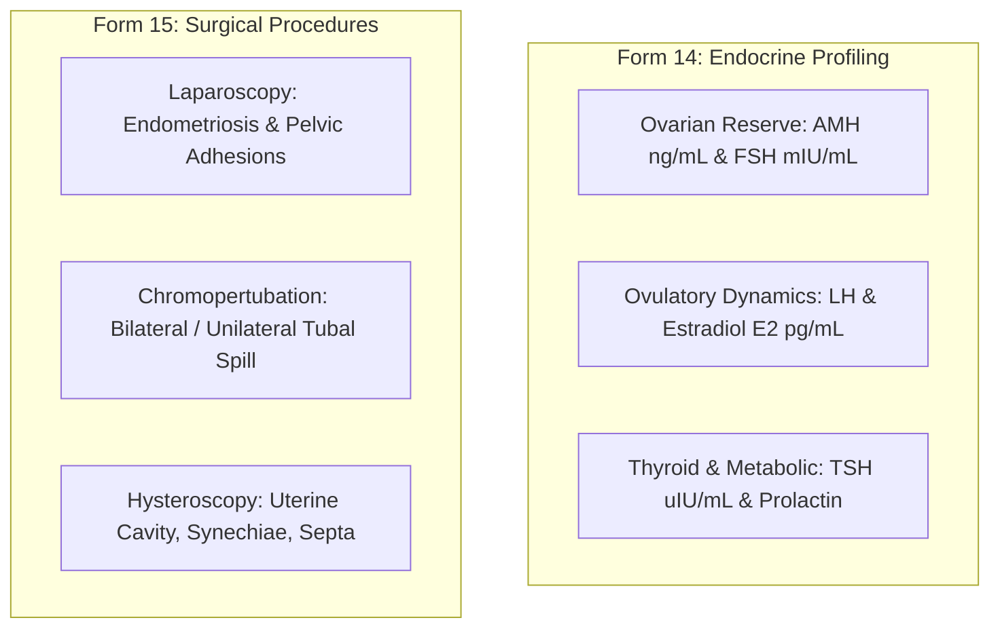

# Presentation Notes: 2026-10-06
## Topic: Reproductive Endocrinology & Surgical Investigations (Forms 14 & 15)

---

### Slide 1: Executive Summary & Milestone Achievement
* **Core Achievements**:
  - Implemented and published **Forms 14 and 15**: Form 14 (*Investigation Female Blood Hormone*) and Form 15 (*Investigation Female Surgical Procedure*).
  - Enforced standardized units and relational bounds across 8 critical endocrine biomarkers (AMH, FSH, LH, E2, TSH, Prolactin).
  - Structured laparoscopic pelvic evaluation, chromopertubation tubal spill, and hysteroscopic endometrial cavity assessment.
* **Clinical Significance**: Gives reproductive endocrinologists instant visibility into ovarian reserve (AMH/FSH) and pelvic/tubal architecture before starting stimulation.

---

### Slide 2: Endocrine & Operative Investigation Mapping

#### What Clinicians See:
1. **Endocrine Summary**: Clear numeric values with standardized units, immediately flagging diminished reserve (`AMH < 1.1 ng/mL`) or hyperprolactinemia.
2. **Surgical Checklist**: Structured cards separating laparoscopic pelvic observations from hysteroscopic cavity evaluations.
3. **Tubal Patency Indicators**: Direct indicator of chromopertubation outcomes informing IVF vs IUI decision pathways.

---

### Slide 3: Engineering Decisions & Post-Mortem

#### The Problems Solved:
1. **Assay Unit Discrepancies**:
   - Enforced database-level standardization to pg/mL for Estradiol and ng/mL for AMH.
2. **Unstructured Operative Notes**:
   - Replaced narrative paragraphs with structured anatomical checkboxes (Peritoneum, Ovaries, Tubes, Cavity).
3. **High-Precision Numeric Handling**:
   - Supported two-decimal precision for severe ovarian insufficiency tracking.

---

### Slide 4: Key Platform Metrics

| Metric | Before Sprint | After Sprint |
|---|---|---|
| **Active Clinical Forms** | 13 forms | **15 forms active** |
| **Endocrine Biomarkers** | Unstructured | **8 Standardized Hormonal Concepts** |
| **Surgical Classifications** | Narrative text | **Discrete Laparoscopy / Hysteroscopy Concepts** |
| **Git Commits Executed** | — | **2 commits** |

---

### Slide 5: Standup Talking Points for PI
1. **Forms 14 and 15 Live**: Implemented baseline female blood hormones and female surgical/laparoscopic procedures.
2. **Ovarian Reserve Standards**: Digitized AMH and baseline gonadotropins with strict unit validation to protect subsequent stimulation dosing.
3. **Structured Operative Checklists**: Decomposed operative laparoscopy and hysteroscopy into anatomical categories for reliable surgical research.
