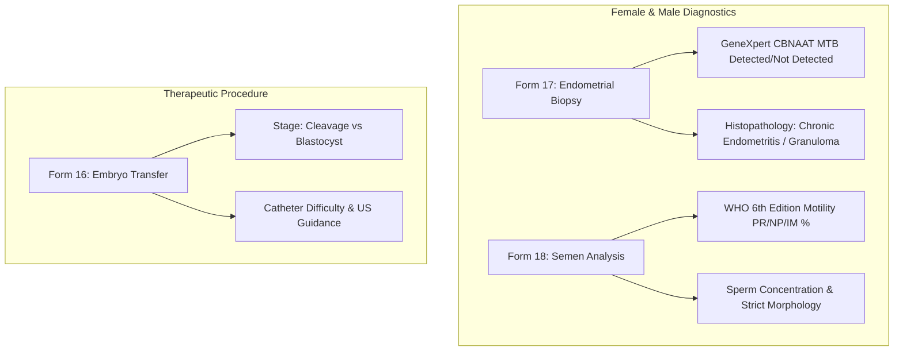

# Presentation Notes: 2026-10-08
## Topic: Diagnostic Expansion: Endometrial Biopsy, Semen Analysis & Embryo Transfer (Forms 16–18)

---

### Slide 1: Executive Summary & Milestone Achievement
* **Core Achievements**:
  - Implemented and published **Forms 16, 17, and 18**: Form 16 (*Procedure Embryo Transfer*), Form 17 (*Investigation Female Procedure Biopsy*), and Form 18 (*Investigation Male Semen*).
  - Modeled structured molecular TB diagnosis (GeneXpert/CBNAAT, AFB, HPE) for endometrial biopsy.
  - Standardized male andrology parameters to WHO 6th Edition guidelines.
* **Clinical Significance**: Provides comprehensive male factor diagnostic records and structured endometrial receptivity/pathology screening, critical for high-prevalence TB regions.

---

### Slide 2: Clinical Diagnostic & Procedural Coverage

#### Key Capabilities:
1. **Endometrial Biopsy Card**: Clear visual distinction for TB screening, highlighting molecular CBNAAT and microbiological findings.
2. **WHO 6th Edition Semen Card**: Clean presentation of sperm concentration, progressive motility %, and diagnostic category (e.g. Oligoasthenoteratozoospermia).
3. **Embryo Transfer Tracking**: Records transfer catheter type, procedural difficulty, and ultrasound visualization.

---

### Slide 3: Engineering Decisions & Post-Mortem

#### The Problems Solved:
1. **Structured Genital TB Alerts**:
   - Replaced unstructured narrative notes with discrete molecular, AFB, and histopathological concepts for clinical decision support.
2. **Semen Volume Precision**:
   - Corrected `concept_numeric` from integer to floating-point (`allow_decimal = 1`) to preserve decimal volumes.
3. **WHO Motility Normalization**:
   - Enforced progressive (PR) motility categorization over deprecated 4-tier scales.

---

### Slide 4: Key Platform Metrics

| Metric | Before Sprint | After Sprint |
|---|---|---|
| **Active Clinical Forms** | 15 forms | **18 forms active** |
| **Diagnostic Coverage** | Ultrasound & Blood Hormones | **Ultrasound, Hormones, Biopsy, Semen** |
| **WHO Compliance** | None | **WHO 6th Edition Andrology Standards** |
| **Git Commits Executed** | — | **3 commits** |

---

### Slide 5: Standup Talking Points for PI
1. **Forms 16, 17, and 18 Live**: Digitized the embryo transfer procedure, endometrial biopsy for TB, and male semen analysis.
2. **Infectious Disease Safety**: Structured molecular GeneXpert MTB detection directly in the female biopsy module to prevent transferring embryos into active TB endometrium.
3. **Standardized Andrology**: Implemented WHO 6th edition criteria for sperm concentration and motility metrics.
