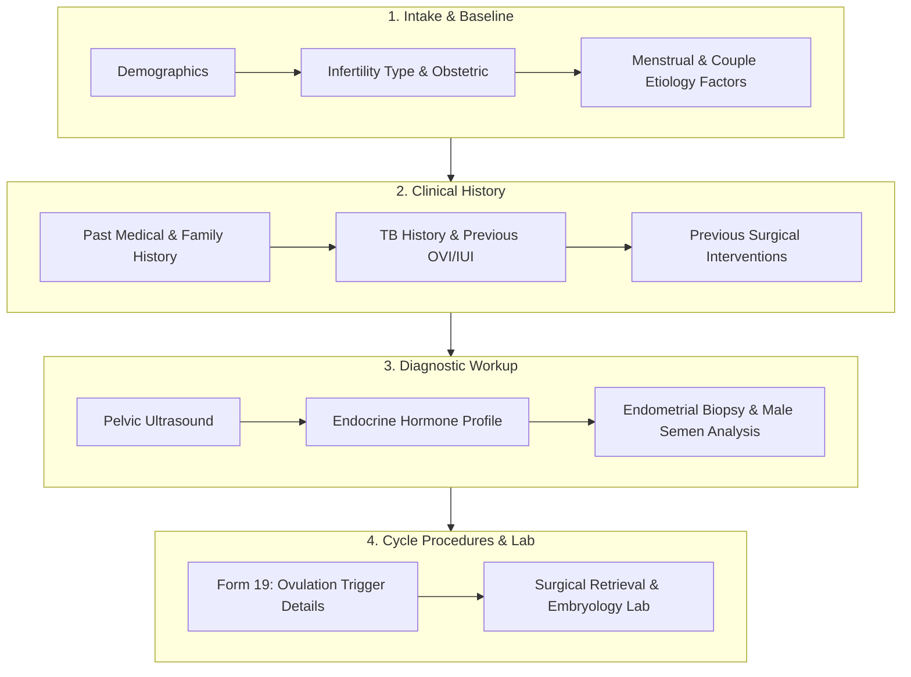

# Presentation Notes: 2026-10-09
## Topic: Clinical Sidebar Chronology, Prior IVF Cycles & Ovulation Trigger (Form 19)

---

### Slide 1: Executive Summary & Milestone Achievement
* **Core Achievements**:
  - Reordered the entire AIIMS clinical sidebar navigation across all 19 registered forms to strictly follow real-world IVF clinical chronology.
  - Delivered Form 19 (*Trigger Details*) with dual-trigger options and endometrial receptivity parameters.
  - Enhanced Form 8 (*Previous OVI & IUI*) to record prior IVF cycle history, protocols, and outcomes.
* **Clinical Significance**: Significantly reduces chart navigation time for clinicians during busy OPD clinics by grouping baseline intake, clinical history, diagnostics, and procedures into logical phases.

---

### Slide 2: Reorganized Clinical Workflow Phases

---

### Slide 3: Engineering Decisions & Post-Mortem

#### The Problems Solved:
1. **Unordered Clinical Navigation**:
   - Replaced development-order sidebar sorting with 4 distinct clinical treatment phases.
2. **Endometrial Receptivity Modeling**:
   - Structured trigger-day endometrial pattern (Trilaminar, Hyperechoic, Fluid) and serum progesterone levels to support cycle cancellation auditing.
3. **Route Drift Diagnosis**:
   - Identified synchronization drift between `form-registry.ts` and `routes.json`, highlighting the requirement for single-sourced route code generation.

---

### Slide 4: Key Platform Metrics

| Metric | Before Sprint | After Sprint |
|---|---|---|
| **Registered Clinical Forms** | 18 forms | **19 forms active** |
| **Sidebar Navigation UX** | Random development order | **Strict clinical chronology** |
| **Historical Cycle Tracking** | Limited to IUI | **Comprehensive OVI + IVF history** |
| **Git Commits Executed** | — | **3 commits** |

---

### Slide 5: Standup Talking Points for PI
1. **Clinically Reordered Navigation**: The patient chart sidebar now mirrors the exact 4-stage IVF clinical workflow from intake to procedure.
2. **Form 19 Live**: Digitized ovulation trigger administration, including dual-trigger dosing and trigger-day endometrial patterns.
3. **Enhanced Historical Depth**: Captured prior IVF cycles and embryology history in Form 8 for accurate prognosis evaluation.
