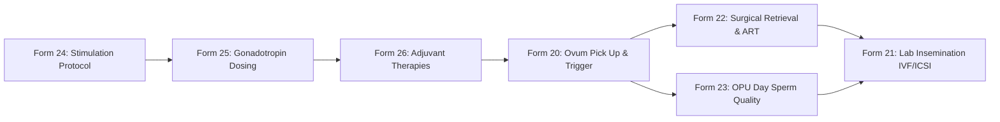

# Presentation Notes: 2026-10-12
## Topic: Surgical Retrieval, Pharmacology & Ovarian Stimulation Sprints (Forms 20–26)

---

### Slide 1: Executive Summary & Milestone Achievement
* **Core Achievements**:
  - Delivered **7 clinical forms and dashboards in a single high-velocity sprint**: Form 20 (*OPU Details*), Form 21 (*Lab Insemination*), Form 22 (*Procedure*), Form 23 (*Sperm Quality Assessment*), Form 24 (*Ovarian Stimulation Protocol*), Form 25 (*Dose of Drugs*), and Form 26 (*Adjuvant Drug*).
  - Expanded the active clinical forms registry from 19 to 26 forms.
  - Registered 60+ new medical concepts with full MariaDB validation and `concept_numeric` metadata.
* **Clinical Significance**: Digitize the critical bridge between reproductive endocrinology stimulation protocols, surgical oocyte retrieval, and the embryology laboratory.

---

### Slide 2: The Surgical & Pharmacological Pathway

#### What Clinicians See:
1. **Stimulation & Pharmacology**:
   - Starting vs total doses of rFSH, hMG, and rLH, Cetrotide timing, and total stimulation days.
   - Dynamic tracking of Growth Hormone (GH) adjuvants.
2. **Surgical Retrieval**:
   - Precise trigger-to-OPU interval hours, follicle output rates (FORT), and oocyte maturity breakdown (MII, MI, GV, abnormal).
   - Unified procedure tracking for PESA/TESA/TESE alongside Laser-Assisted Hatching and Embryo Glue.
3. **Insemination Protocol**:
   - Insemination method (Conventional IVF vs ICSI vs Split) and post-wash motility parameters.

---

### Slide 3: Architectural Decisions & Post-Mortem

#### The Problems Solved:
1. **Sidebar Extension Clutter**:
   - Merged Sperm Retrieval and Additional ART procedures into a unified form (`aiims-procedure`), eliminating redundant sidebar tabs.
2. **Selective Form Branching**:
   - Applied declarative AMPATH `hideWhenExpression` logic for conditional adjuvant dosing.
3. **Collision Avoidance**:
   - Resolved routing collision between Form 22 rename and Form 23 sperm quality assessment.

---

### Slide 4: Key Platform Metrics

| Metric | Before Sprint | After Sprint |
|---|---|---|
| **Active Clinical Forms** | 19 forms | **26 forms (7 delivered)** |
| **Active Medical Concepts** | 240+ concepts | **303 unique concepts** |
| **Unit Test Suite** | 56 tests | **70 passing tests** |
| **Git Commits Executed** | — | **8 commits** |

---

### Slide 5: Standup Talking Points for PI
1. **7 Forms in One Day**: Successfully delivered the entire surgical retrieval and stimulation protocol suite (Forms 20–26).
2. **Unified Clinical Procedure Modeling**: Consolidated operative sperm retrieval and advanced ART procedures into a single cohesive intake interface.
3. **Embryology Ready**: With stimulation, OPU, and insemination fully digitized, the platform is ready for the day-by-day embryology lab module.
