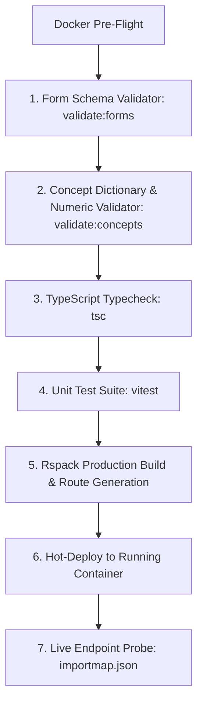

# Presentation Notes: 2026-10-14
## Topic: Quality Gate Armor & Form 27 (Assessment of Fertilization, Embryo & Blastocyst)

---

### Slide 1: Executive Summary & Milestone Achievement
* **Core Achievement**: Completed full end-to-end delivery of Form 27 (Assessment of Fertilization, Embryo & Blastocyst).
* **Clinical Significance**: Provides embryologists with structured digital documentation for daily cleavage stages (Days 1–3) and blastocyst progression (Days 4–6), replacing manual paper embryology cards.
* **Engineering Hardening**: Closed all boundary gaps between the Single-SPA frontend microfrontend and the OpenMRS Form Engine with automated 7-gate quality checks.

---

### Slide 2: Clinical Workflow Impact (The Embryology Lifecycle)

#### What Clinicians & Embryologists See:
1. **At-a-Glance Dashboard**:
   - Day 1 Fertilization summary (2PN count and grades).
   - Day 2 & Day 3 cleavage progression with cell stage and morphological grade.
   - Day 4–6 blastocyst development and Gardner grading scale (1AA to 6CC).
2. **Interactive Form Intake**:
   - Direct "Record" / "Update" button on patient chart.
   - Mobile and tablet responsive for clean lab bench data entry.

---

### Slide 3: Engineering Post-Mortem & Preventive Architecture

#### The Problem Solved:
* In OpenMRS 3.x, frontend dashboards and backend form engine schemas are decoupled.
* A form could compile cleanly in TypeScript but fail when saving observations due to relational database rules (`concept_numeric`).

#### The Automated Armor:

1. **Zero Silent Failures**: Every deployment automatically checks that all 27 form schemas are published and valid.
2. **Deep Relational Validation**: Checks every question concept and answer concept across 4,828 database entries in under 4 seconds.
3. **Interactive Smoke Test Robot**: Headless Chromium clicks "Record" in the live patient chart to ensure the workspace loads without error.

---

### Slide 4: Key Platform Metrics
* **Total Active Forms**: 27 Forms across the entire fertility journey (intake -> stim -> OPU -> lab -> ET).
* **Concept Registry Coverage**: 316 unique medical concepts, 100% active and validated.
* **Unit Tests**: 74 automated unit tests running in Vitest.
* **Deployment Speed**: Complete 7-stage quality pipeline builds, validates, and hot-deploys in **under 40 seconds**.
