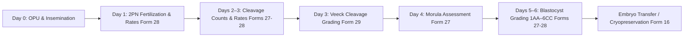
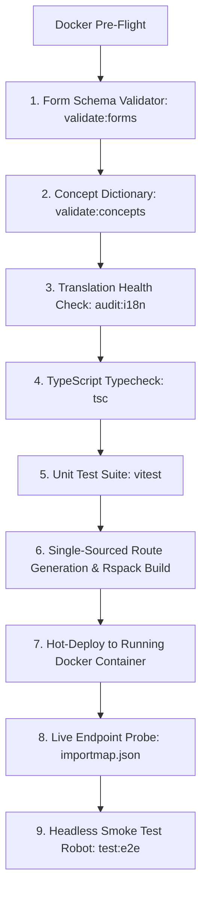

# Presentation Notes: 2026-10-14
## Topic: Quality Gate Armor, Forms 27, 28 & Form 29 (Embryo Grading Day 3)

---

### Slide 1: Executive Summary & Milestone Achievement
* **Core Achievements**:
  - Full end-to-end delivery of Form 27 (*Assessment of Fertilization, Embryo & Blastocyst*), Form 28 (*Fertilisation Details*), and Form 29 (*Embryo Grading Day 3*).
  - Added Wife/Patient Body Mass Index (BMI) to Demographics Intake, PatientCard, and sticky DemographicsSummaryWidget.
  - Closed all boundary gaps with an automated **9-stage quality deployment pipeline** and targeted sub-second form publishing.
* **Clinical Significance**: Provides embryologists and fertility specialists with structured digital tracking for oocyte fertilization, cleavage rates (Days 2, 3, 5), Veeck/Istanbul Day 3 cleavage embryo grading (Grades 1–4), and blastocyst grading (Days 4–6), completely eliminating manual paper embryology records.

---

### Slide 2: Clinical Workflow Impact (The IVF Laboratory & Embryology Lifecycle)

#### What Clinicians & Embryologists See:
1. **At-a-Glance Dashboards**:
   - Number of Oocytes Fertilised and Fertilisation Rate (%).
   - Cleaved embryos on Day 2, Cleavage Rate (%), Day 3, and Day 5 blastocyst counts.
   - Day 3 Veeck/Istanbul cleavage embryo grading (Grade 1, 2, 3, 4) and auto-computed total embryos.
   - Day 1–6 morphological grading (Gardner scale 1AA to 6CC) and embryology remarks.
2. **Patient Demographics Overview**:
   - Wife's BMI displayed alongside Husband's BMI on the patient card and top header widget.
3. **Contiguous Clinical Navigation**:
   - Locked sidebar sorting (`order: 1`) ensures all 29 AIIMS clinical intake forms appear in unified clinical sequence without interruption from core OpenMRS links.

---

### Slide 3: Engineering Post-Mortem & Preventive Architecture

#### The Problems Solved:
1. **Relational Concept Database Rule (`concept_numeric`)**:
   - Catching missing `concept_numeric` rows before observation save (prevented OpenMRS `ConceptNumeric.getAllowDecimal()` NPEs).
2. **Sidebar Interleaving (`order` defect)**:
   - Fixed automated scaffolder to prevent incrementing `order` beyond 1, keeping all custom forms grouped contiguously ahead of core OpenMRS chart links.
3. **i18n String Safety**:
   - Added pre-flight `audit:i18n` gate to ensure zero runtime missing translation keys.

#### The 9-Stage Automated Pipeline:

---

### Slide 4: Key Platform Metrics

| Metric | Previous (Morning) | Current (Form 29 Live) |
|---|---|---|
| **Total Registered Clinical Forms** | 26 | **29 Forms Active & Published** |
| **Concept Registry Coverage** | 303 | **329 Unique Medical Concepts** |
| **Numeric Concepts with Metadata** | 79 | **91 Fully Verified** |
| **Automated Unit Tests** | 70 | **81 Passing Tests (32 test suites)** |
| **i18n Translation Health** | Unchecked | **100% Populated (0 missing)** |
| **Active Frontend Bundle** | `1.0.71` | **`1.0.79` (HTTP 200 Live Verified)** |

