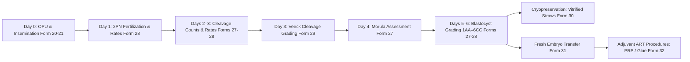
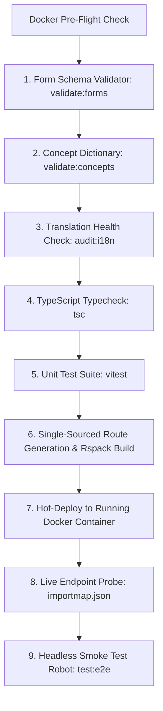

# Presentation Notes: 2026-10-14
## Topic: Quality Gate Armor, Forms 27–32 & Laboratory Embryology Lifecycle

---

### Slide 1: Executive Summary & Milestone Achievement
* **Core Achievements**:
  - Full end-to-end delivery of **6 clinical forms**: Form 27 (*Embryo Assessment*), Form 28 (*Fertilisation Details*), Form 29 (*Embryo Grading Day 3*), Form 30 (*Embryos Frozen*), Form 31 (*Fresh ET Details*), and Form 32 (*Additional Procedures in ART*).
  - Added Wife/Patient Body Mass Index (BMI) to Demographics Intake, PatientCard, and sticky DemographicsSummaryWidget.
  - Closed all quality boundary gaps with an automated **9-stage quality deployment pipeline** and targeted sub-second form publishing.
* **Clinical Significance**: Provides embryologists and fertility specialists with structured digital tracking for oocyte fertilization, cleavage rates (Days 2, 3, 5), Veeck/Istanbul Day 3 cleavage embryo grading (Grades 1–4), Gardner blastocyst grading (Days 4–6), cryopreservation vitrification straws, and embryo transfer procedures, completely eliminating manual paper records.

---

### Slide 2: Clinical Workflow Impact (The IVF Laboratory & Embryology Lifecycle)

#### What Clinicians & Embryologists See:
1. **At-a-Glance Dashboards**:
   - Number of Oocytes Fertilised and Fertilisation Rate (%).
   - Cleaved embryos on Day 2, Cleavage Rate (%), Day 3, and Day 5 blastocyst counts.
   - Day 3 Veeck/Istanbul cleavage embryo grading (Grade 1, 2, 3, 4) and alphanumeric embryology notations.
   - Day 1–6 morphological grading (Gardner scale 1AA to 6CC) and embryology remarks.
   - Cryopreservation metrics: Day 3/5 vitrified counts and straw numbers.
   - Fresh ET procedure outcomes, cancellation etiologies, and adjuvant treatments (PRP, G-CSF, Embryo Glue).
2. **Patient Demographics Overview**:
   - Wife's BMI displayed alongside Husband's BMI on the patient card and top header widget.
3. **Contiguous Clinical Navigation**:
   - Locked sidebar sorting (`order: 1`) ensures all 32 AIIMS clinical intake forms appear in unified clinical sequence without interruption from core OpenMRS links.

---

### Slide 3: Engineering Post-Mortem & Preventive Architecture

#### The Problems Solved:
1. **Relational Concept Database Rule (`concept_numeric`)**:
   - Catching missing `concept_numeric` rows before observation save (prevented OpenMRS `ConceptNumeric.getAllowDecimal()` NPEs).
2. **Sidebar Interleaving (`order` defect)**:
   - Fixed automated scaffolder to prevent incrementing `order` beyond 1, keeping all custom forms grouped contiguously ahead of core OpenMRS chart links.
3. **i18n String Safety**:
   - Added pre-flight `audit:i18n` gate to ensure zero runtime missing translation keys.
4. **Conditional Skip-Logic Rendering**:
   - Solved null-to-active radio button rendering bugs in `@openmrs/esm-form-engine-lib` by binding expressions to question objects.

#### The 9-Stage Automated Pipeline:

---

### Slide 4: Key Platform Metrics

| Metric | Previous (Morning) | End of Day (Form 32 Live) | Status |
|---|---|---|---|
| **Total Registered Clinical Forms** | 26 | **32 Forms Active & Published** | Complete |
| **Concept Registry Coverage** | 303 | **350 Unique Medical Concepts** | 100% Validated |
| **Numeric Concepts with Metadata** | 79 | **95 Fully Verified in MariaDB** | 100% Validated |
| **Automated Unit Tests** | 70 | **92 Passing Tests (35 test suites)** | 100% Green |
| **i18n Translation Health** | Unchecked | **100% Populated (0 missing keys)** | Audited |
| **Active Frontend Bundle** | `1.0.71` | **`1.0.82` (HTTP 200 Live Verified)** | Deployed |

---

### Slide 5: Standup Talking Points for PI
1. **Full Embryology Pipeline Live**: Transitioned the complete laboratory cycle (insemination, cleavage grading, blastocyst Gardner scores, vitrification, and embryo transfer) into structured digital forms.
2. **Zero Deployment Failures**: Engineered a 9-stage zero-downtime deployment pipeline and Playwright smoke robot, eliminating runtime crashes and broken schemas.
3. **Database Integrity Armor**: Implemented automated relational concept validation preventing OpenMRS backend 500 errors.
