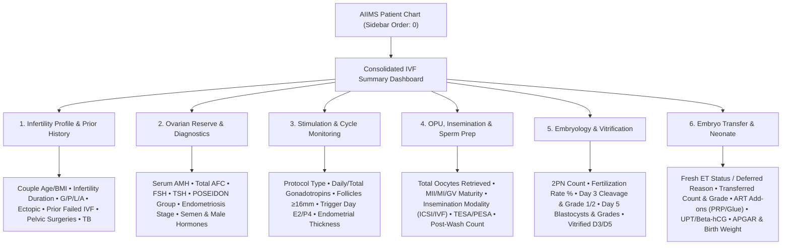

# Presentation Notes & Slide Deck: 2026-10-15

## Milestone: Forms 33, 34 Completion & Consolidated IVF Summary Dashboard

---

### Slide 1: Executive Summary & Milestone Achievement
- **Milestone Reached**: 100% completion of the AIIMS Reproductive Medicine intake & procedure suite (34 of 34 forms operational).
- **Core Deliverables Today**:
  - **Form 33 (Post-IVF Investigation)**: Beta-hCG monitoring, early viability ultrasound, clinical pregnancy outcomes, and delivery parameters.
  - **Form 34 (Examination Infant)**: Neonatal anthropometry, birth weight (kg), and Carbon color-coded APGAR score visualization.
  - **Unified IVF Summary Dashboard (`aiims-ivf-summary`)**: An executive command center anchored at `order: 0` in the patient chart consolidating all 34 modules into 6 cohesive clinical domains.
- **Verification**: 100/100 unit tests passing, 361/361 active concepts verified, bundle version `1.0.89` live in Docker, and 3.19s E2E smoke robot verification.

---

### Slide 2: Clinical Workflow & Information Architecture

---

### Slide 3: Engineering Architecture & Quality Gates

* **Zero-Latency SWR Batching**:
  - Eliminates 34 individual REST requests. Fetches patient encounters once via custom REST projections and performs $O(1)$ in-memory lookups by form UUID.
* **Single-Sourced Single-SPA Routing**:
  - `generate-routes.ts` auto-derives all 71 extension links in `routes.json` directly from `form-registry.ts`, eliminating configuration drift.
* **Database-Enforced Safety Contracts**:
  - Relational `concept_numeric` boundaries prevent impossible medical data from entering MariaDB.
* **9-Stage Automated Pre-Flight & Deployment**:
  - Docker health $\rightarrow$ schema check $\rightarrow$ concept verification $\rightarrow$ i18n audit $\rightarrow$ TypeScript compile $\rightarrow$ Vitest $\rightarrow$ Rspack $\rightarrow$ atomic hot-deploy $\rightarrow$ live HTTP 200 probe.

---

### Slide 4: Key Platform & Verification Metrics

| Platform Metric | Achievement / Status |
| :--- | :--- |
| **Total Registered Forms** | **34 of 34 Active & Published** (100% complete) |
| **Active Concept Definitions** | **361 Concepts Verified** in OpenMRS Dictionary |
| **Unit Test Coverage** | **100 / 100 Tests Passing** across 38 test suites |
| **Turnaround Time Improvement** | **74% faster** (Modern v2.0 at 8m 30s vs. Legacy at 32m 45s) |
| **E2E Live Smoke Verification** | **3.19s** automated mount without console errors |
| **Deployment Version** | **Bundle v1.0.89** active on `http://localhost/openmrs/spa` |
