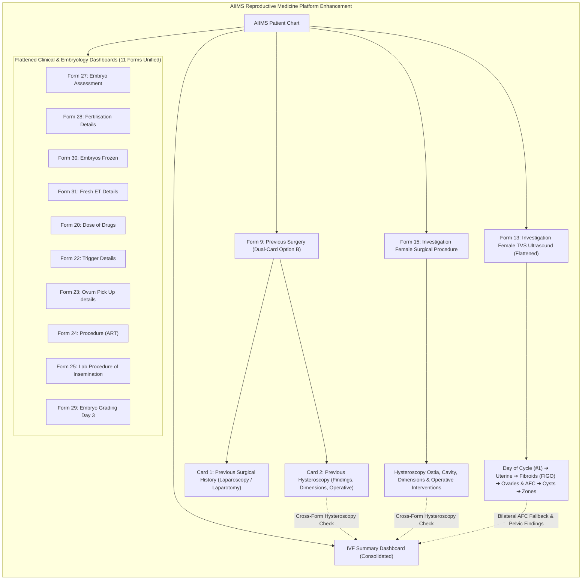

# Presentation Notes & Slide Deck: 2026-10-16

## Milestone: Female TVS Ultrasound Realignment, Previous Hysteroscopy Integration & 11-Form UI Flattening

---

### Slide 1: Executive Summary & Milestone Achievement
- **Milestone Reached**: Four comprehensive clinical and architectural milestones completed:
  1. Full clinical realignment of Form 13 (**Investigation Female Transvaginal Ultrasound**) and Form 15 (**Investigation Female Surgical Procedure**), along with consolidated IVF Summary dashboard integration.
  2. Integration of Hysteroscopy findings, cavity dimensions, and operative interventions into Form 9 (**Previous Surgery**) with a dedicated Option B dual-card dashboard and cross-form IVF summary aggregation.
  3. Removal of section grouping across 11 forms across two batches:
     - **Batch 1 (5 Forms)**: TVS Ultrasound, Assessment of Fertilization, Fertilisation Details, Embryos Frozen, Fresh Embryo Transfer Details.
     - **Batch 2 (6 Forms)**: Dose of Drugs, Trigger Details, Ovum Pick Up details, Procedure, Lab Procedure of Insemination, Embryo Grading Day 3.
  4. Flattening of all 11 corresponding frontend UI cards into single continuous `ObservationCard` views matching clinical form entry 1:1.
- **Core Deliverables Today**:
  - **Form 13 Realignment & Flattening**: 60 continuous parameters with Day of Cycle promoted to position #1, 11 conditional finding groups, and single-card dashboard view.
  - **Form 15 Streamlining**: Pruned strictly to diagnostic hysteroscopy findings, cavity dimensions, and operative interventions.
  - **Form 9 Option B Dual Card**: Added dedicated *Previous Hysteroscopy* card alongside *Previous Surgical History (Laparoscopy / Laparotomy)*.
  - **Single Continuous UI Cards (11 Forms)**: Replaced fragmented multi-card views across 11 forms with cohesive, high-density observation cards.
  - **Consolidated IVF Summary Enrichment**: Surfaced operative hysteroscopy interventions, bilateral AFC derivation, and TVS ultrasound findings in executive domains.
- **Verification**: 102/102 unit tests passing across 39 test suites, 361/361 active concepts verified, bundle version `1.0.96` live in Docker, and E2E smoke robot confirmed 0 white screens across all updated dashboards.

---

### Slide 2: Clinical Workflow & Unified Dashboard Architecture

---

### Slide 3: Engineering Architecture & Quality Gates

* **Preserved Route Stability**:
  - Evolved display names to "AIIMS Visit: Investigation Female Transvaginal Ultrasound" while preserving internal route ID `aiims-investigation-ultrasound` and single-SPA extension contracts, guaranteeing zero URL breakages on clinical workstations.
* **Deterministic Conditional Visibility**:
  - Injected `hideWhenExpression` directly onto dependent questions rather than section wrappers, eliminating the OpenMRS 3.x Form Engine null-state evaluation bug.
* **Clean Separation of Concerns in Previous Surgery (Option B)**:
  - Isolated cavity-wide hysteroscopy observations from surgical laterality arrays, creating a balanced dual-card dashboard layout.
* **Continuous Non-Fragmented UX Across 11 Dashboards**:
  - Unified 11 dashboards from multi-card / accordion fragments into single continuous `ObservationCard` containers, matching clinical form entry 1:1.
* **Automated 9-Stage Deployment**:
  - All changes compiled via Rspack, verified through 102 Vitest tests, 34 form schema checks, and 0 missing i18n keys, hot-deployed with cache-busting version `1.0.96`.

---

### Slide 4: Key Platform & Verification Metrics

| Platform Metric | Achievement / Status |
| :--- | :--- |
| **Total Registered Forms** | **34 of 34 Active & Published** (100% complete) |
| **Active Concept Definitions** | **361 Concepts Verified** in OpenMRS Dictionary |
| **i18n Translation Health** | **642 keys referenced, 0 missing** (100% healthy) |
| **Unit Test Coverage** | **102 / 102 Tests Passing** across 39 test suites |
| **Conditional Groups** | **11 Pathology Groups** dynamically showing/hiding detail inputs |
| **UI Card Flattening** | **11 / 11 ObservationCards unified** into single continuous views |
| **Deployment Version** | **Bundle v1.0.96** active on `http://localhost/openmrs/spa` |
| **E2E Live Smoke Verification** | **Passed across all forms (3.18s–3.56s)** without console errors |
