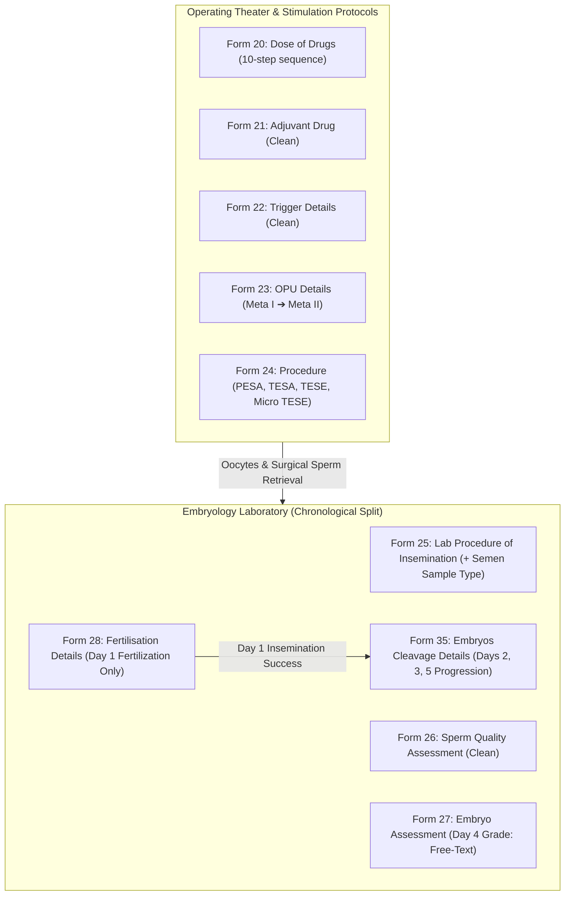

# Presentation Notes & Standup Briefing: 2026-10-22

## Milestone: IVF Clinical Adjustments, Embryo Cleavage Form 35 & Datatype Migration

---

### Slide 1: Executive Summary & Milestone Deliverables
- **Core Milestone Reached**:
  Executed Phase 2 clinical refinements across the entire IVF clinical intake and embryology suite, resolving a core data migration defect and delivering Form 35:
  1. **Batch 2 Clinical Form Adjustments (8 Forms)**:
     - *Dose of Drugs (Form 20)*: Reordered 10 parameters to match clinical sheet sequence; removed remarks.
     - *Adjuvant Drug (Form 21)*: Pruned remarks.
     - *Trigger Details (Form 22)*: Pruned remarks.
     - *Ovum Pick Up Details (Form 23)*: Reordered maturity grading (Metaphase I before Metaphase II); pruned remarks.
     - *Procedure (Form 24)*: Decoupled sample type from surgical procedure; added TESE and Micro TESE; pruned remarks.
     - *Lab Procedure of Insemination (Form 25)*: Added Semen Sample Type (Frozen, Donor Semen, Husband Semen); pruned remarks.
     - *Sperm Quality Assessment (Form 26)*: Pruned remarks.
     - *Embryo Assessment (Form 27)*: Migrated Day 4 Embryo Grade from Coded dropdown to free-text; pruned remarks.
  2. **Day 4 Concept Datatype Fix & Data Migration**:
     - Diagnosed and resolved Form Engine concept UUID leak and save failure on `c0010001-...-0255`.
     - Migrated historical MariaDB `obs` rows (`value_coded = NULL, value_text = '...'`).
     - Added self-healing migration logic in `setup_aiims_concepts.py`.
  3. **Fertilisation Details Refactoring & Embryos Cleavage Details (Form 35)**:
     - Pruned remarks and extracted Day 2, 3, 5 cleavage metrics from Form 28.
     - Created and published Form 35 (*Embryos Cleavage Details*).
     - Scaffolded Single-SPA dashboard, auto-generated routes, and verified multi-form fallback in IVF Summary dashboard.

---

### Slide 2: Clinical Workflow & Domain Alignment

---

### Slide 3: Architectural Decision Highlights (ADRs)
- **ADR-017 (Surgical Retrieval vs. Sample Origin)**:
  - Surgical theater sheet (*Procedure*) strictly models clinical interventions (PESA, TESA, TESE, Micro TESE).
  - Semen preservation and origin (Frozen, Donor Semen, Husband Semen) moved to cleanroom insemination protocol.
- **ADR-018 (Day 4 Morphology Free-Text Migration)**:
  - Replaced rigid Morula dropdown with descriptive free-text to support nuanced compaction and cavitation reporting.
- **ADR-019 (Systematic Remarks Pruning)**:
  - Eliminated trailing free-text remarks sections across 9 forms to maximize observation card density and prevent unstructured clinical leakage.
- **ADR-020 (Independent Cleavage Progression Form)**:
  - Extracted Day 2–5 cleavage parameters into Form 35 (*Embryos Cleavage Details*), allowing Day 1 fertilization to be finalized without blocking subsequent cleavage data entry.

---

### Slide 4: Platform Quality Gates & Verification Metrics
| Quality Gate | Target | Result | Status |
|:---|:---:|:---:|:---:|
| Registered Clinical Forms | $\ge 35$ | **35 forms active & published** | Passed |
| Concept Dictionary Integrity | $\ge 370$ | **370 active concepts verified** | Passed |
| Missing i18n Translation Keys | $0$ | **0 missing keys (751 total)** | Passed |
| TypeScript Strict Compilation | 0 errors | **0 errors (`noImplicitAny`)** | Passed |
| Vitest Unit Test Suites | 40 suites | **40 passed (105 tests)** | Passed |
| Production Build (Rspack) | Success | **Compiled cleanly (14.04s)** | Passed |
| Live Endpoint Verification | HTTP 200 | **HTTP 200 OK** | Passed |
| Deployment Pipeline Duration | $< 300\text{s}$ | **122.14s (Bundle v1.0.102)** | Passed |
