# Presentation Notes & Standup Briefing: 2026-10-22

## Milestone: IVF Clinical Adjustments, Embryos Cleavage Details (Form 35), and 100% 35-Form IVF Summary Federation

---

### Slide 1: Executive Summary & Milestone Deliverables
- **Core Milestone Reached**:
  Executed comprehensive clinical refinements across the entire AIIMS IVF intake, embryology, and neonatal suite, resolving core data migration traps and delivering 100% clinical federation in the IVF Summary:
  1. **Batch 2 Clinical Form Adjustments (8 Forms)**:
     - *Dose of Drugs (Form 20)*: Reordered 10 parameters to match clinical sheet sequence; removed remarks.
     - *Adjuvant Drug (Form 21)*: Pruned remarks.
     - *Trigger Details (Form 22)*: Pruned remarks.
     - *Ovum Pick Up Details (Form 23)*: Reordered maturity grading (Metaphase I before Metaphase II); pruned remarks.
     - *Procedure (Form 24)*: Decoupled sample type from surgical procedure; added TESE and Micro TESE; pruned remarks.
     - *Lab Procedure of Insemination (Form 25)*: Added Semen Sample Type (Frozen, Donor Semen, Husband Semen); pruned remarks.
     - *Sperm Quality Assessment (Form 26)*: Pruned remarks.
     - *Embryo Assessment (Form 27)*: Migrated Day 4 Embryo Grade from Coded dropdown to free-text; pruned remarks.
  2. **Day 4 Concept Datatype Fix & Data Migration**:
     - Diagnosed and resolved Form Engine concept UUID leak and save failure on `c0010001-...-0255`.
     - Migrated historical MariaDB `obs` rows (`value_coded = NULL, value_text = '...'`).
     - Added self-healing migration logic in `setup_aiims_concepts.py`.
  3. **Fertilisation Details Refactoring & Embryos Cleavage Details (Form 35)**:
     - Pruned remarks and extracted Day 2, 3, 5 cleavage metrics from Form 28.
     - Created and published Form 35 (*Embryos Cleavage Details*).
     - Scaffolded Single-SPA dashboard, auto-generated routes, and verified multi-form fallback in IVF Summary dashboard.
  4. **Batch 3 Clinical Form Adjustments (6 Forms)**:
     - *Embryo Grading Day 3 (Form 29)*: Simplified field labels to `"Grade 1"`, `"Grade 2"`, `"Grade 3"`, `"Grade 4"`.
     - *Embryos Frozen (Form 30)*: Pruned remarks.
     - *Fresh Embryo Transfer Details (Form 31)*: Pruned remarks.
     - *Additional Procedures in Assisted Reproductive Technology (Form 32)*: Expanded title from abbreviation to full clinical standard.
     - *Post-InVitro Fertilisation Investigation (Form 33)*: Pruned `"Inconclusive"` from UPT, enforcing binary diagnostic clarity.
     - *Examination Infant (Form 34)*: Merged sections into single section (ADR-014); converted `"Sex of Baby"` to free text with proactive historical observation migration (ADR-019).
  5. **100% 35-Form IVF Summary Dashboard Federation & Multi-Select Remediation**:
     - Integrated all 35 forms into 6 structured clinical domains (14 ObservationCards) with zero extra network requests.
     - Rectified multi-select checkbox queries via `getFormObsList` across 8 clinical domains, eliminating truncation.
     - Added *Semen Sample Type*, intra-cycle *Additional IVF Procedures*, and *Delivery & Gestation* details.
     - Verified 142/142 concept queries against 35 JSON form schemas with 0 mismatches.

---

### Slide 2: Clinical Workflow & 35-Form Summary Federation

```mermaid
graph TD
    subgraph Domain1["1. Infertility Profile & Prior History"]
        F1["Form 1: Demographics"]
        F2["Form 2: Infertility Type"]
        F3["Form 3: Obstetric History"]
        F4["Form 4: Menstrual History"]
        F7["Form 7: Prev OI & IUI"]
        F8["Form 8: Prev Pelvic Surgery"]
        F10["Form 10: Past Medical History"]
        F11["Form 11: Family History"]
        F12["Form 12: Tuberculosis History"]
    end

    subgraph Domain2["2. Ovarian Reserve & Diagnostic Subtyping"]
        F5["Form 5: Female Factor"]
        F6["Form 6: Male Factor"]
        F9["Form 9: Male Hormone & Surgery"]
        F13["Form 13: TVS Ultrasound"]
        F14["Form 14: Female Blood Hormone"]
        F15["Form 15: Female Surgical Procedure"]
        F17["Form 17: Endometrial Biopsy"]
        F18["Form 18: Male Semen Analysis"]
    end

    subgraph Domain3["3. Stimulation & Cycle Monitoring"]
        F19["Form 19: Stimulation Protocol"]
        F20["Form 20: Dose of Drugs"]
        F21["Form 21: Adjuvant Drug (GH)"]
        F22["Form 22: Trigger Details"]
    end

    subgraph Domain4["4. OPU, Insemination & Laboratory"]
        F23["Form 23: OPU Details"]
        F24["Form 24: Procedure (Surgical)"]
        F25["Form 25: Insemination Lab"]
        F26["Form 26: Sperm Quality Assessment"]
    end

    subgraph Domain5["5. Embryology Culture & Cryopreservation"]
        F27["Form 27: Embryo Assessment"]
        F28["Form 28: Fertilisation Details"]
        F29["Form 29: Embryo Grading Day 3"]
        F30["Form 30: Embryos Frozen"]
        F35["Form 35: Embryos Cleavage Details"]
    end

    subgraph Domain6["6. Embryo Transfer, Outcome & Neonate"]
        F16["Form 16: Mock Embryo Transfer"]
        F31["Form 31: Fresh Embryo Transfer"]
        F32["Form 32: Additional ART Procedures"]
        F33["Form 33: Post-IVF Investigation"]
        F34["Form 34: Examination Infant"]
    end

    Domain1 --> Domain2 --> Domain3 --> Domain4 --> Domain5 --> Domain6
```

---

### Slide 3: Architectural Decision Highlights (ADRs)
- **ADR-017 (Surgical Retrieval vs. Sample Origin)**:
  - Surgical theater sheet (*Procedure*) strictly models clinical interventions (PESA, TESA, TESE, Micro TESE).
  - Semen preservation and origin (Frozen, Donor Semen, Husband Semen) moved to cleanroom insemination protocol.
- **ADR-018 (Day 4 Morphology Free-Text Migration)**:
  - Replaced rigid Morula dropdown with descriptive free-text to support nuanced compaction and cavitation reporting.
- **ADR-019 (Proactive Historical Obs Migration on Datatype Conversion)**:
  - Added self-healing database migration ensuring concept changes from Coded to Text copy concept names to `value_text` and clear `value_coded = NULL`, preventing Form Engine UUID display bugs.
- **ADR-020 (Independent Cleavage Progression Form)**:
  - Extracted Day 2–5 cleavage parameters into Form 35 (*Embryos Cleavage Details*), allowing Day 1 fertilization to be finalized without blocking subsequent cleavage data entry.
- **ADR-021 (Neonatal Sex as Free-Text)**:
  - Supports clinical and diagnostic nuances in neonatal examination without rigid enum constraints.
- **ADR-022 (Binary UPT Diagnostic Categorization)**:
  - Eliminated `"Inconclusive"` qualitative dipstick option, routing all ambiguous cases to quantitative Serum Beta-hCG.
- **ADR-023 (Assisted Reproductive Technology Title Expansion)**:
  - Standardized full official terminology across navigation, routing, schemas, and patient charts.
- **ADR-024 (Multi-Select Observation Array Flattening)**:
  - Introduced `getFormObsList(formUuid, conceptUuid)` in `ivf-summary.resource.ts` to prevent data loss in multi-select diagnostic factors, surgical histories, and laboratory procedures.
- **ADR-025 (Full Clinical Federation of 35 Modules)**:
  - Federates 100% of all 35 clinical modules into a single overview screen with 0 extra network requests.

---

### Slide 4: Platform Quality Gates & Verification Metrics
| Quality Gate | Target | Result | Status |
|:---|:---:|:---:|:---:|
| Registered Clinical Forms | $\ge 35$ | **35 forms active & published** | Passed |
| Concept Dictionary Integrity | $\ge 370$ | **370 active concepts verified** | Passed |
| Concept Query Verification | $100\%$ | **142/142 queries verified (0 mismatches)** | Passed |
| Missing i18n Translation Keys | $0$ | **0 missing keys (753 total)** | Passed |
| TypeScript Strict Check (`noImplicitAny`) | $0\text{ errors}$ | **0 errors (`tsc` passed)** | Passed |
| Vitest Unit Test Suites | $100\%$ | **40/40 passed (106/106 tests)** | Passed |
| Production Bundle Build | Zero warnings | **Rspack compiled successfully (13.35s)** | Passed |
| Docker Hot-Deployment | Container updated | **Bundle `v1.0.105` active in Nginx** | Passed |
| Live SPA Verification Probe | HTTP 200 OK | **Verified on `importmap.json`** | Passed |
