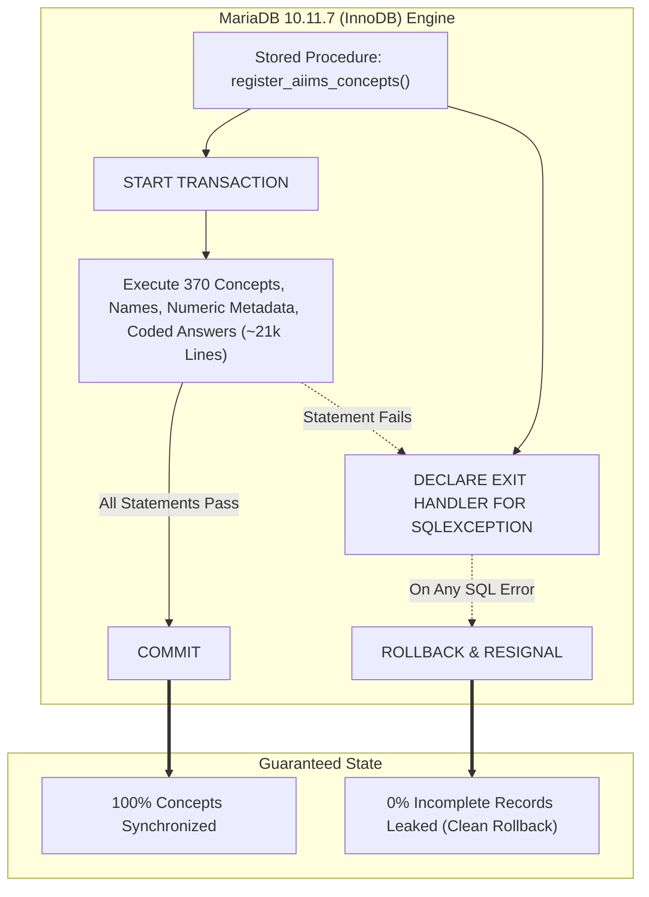
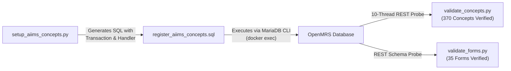

# Presentation Notes & Standup Briefing: 2026-10-26

## Milestone: ACID Transactional Atomicity for AIIMS OpenMRS Concept Migrations

---

### Slide 1: Executive Summary & Milestone Deliverables
- **Core Milestone Reached**:
  Engineered and verified full ACID transactional atomicity for the AIIMS OpenMRS concept and dictionary provisioning pipeline:
  1. **MariaDB Engine Feasibility Audit**:
     - Verified MariaDB `10.11.7` default storage engine is `InnoDB`.
     - Confirmed all OpenMRS concept dictionary tables (`concept`, `concept_name`, `concept_numeric`, `concept_answer`, `concept_reference_term`, `concept_reference_map`) use `InnoDB`, providing native ACID rollback support.
  2. **Stored Procedure Exception & Transaction Handling**:
     - Upgraded the 21,698-line stored procedure `register_aiims_concepts()` in `setup_aiims_concepts.py` and `register_aiims_concepts.sql`.
     - Injected `DECLARE EXIT HANDLER FOR SQLEXCEPTION` with `ROLLBACK; RESIGNAL;`.
     - Bound the entire provisioning body between `START TRANSACTION;` and `COMMIT;`.
  3. **Zero Partial-State Guarantee**:
     - Guaranteed "all-or-nothing" execution. Any unexpected constraint failure, duplicate UUID, or schema mismatch aborts the transaction cleanly without leaving orphaned records.
  4. **Full Automated Verification**:
     - `validate_concepts.py`: 370/370 active relational concepts verified (0 missing, 0 retired).
     - `validate_forms.py`: 35/35 registered clinical intake forms verified active and published.

---

### Slide 2: Transactional Integrity Architecture

---

### Slide 3: Engineering Architecture & Quality Gates

- **Quality Metric**:
  - `validate_concepts.py`: 370/370 concepts validated across 10 threads in 4.93s (75.1 concepts/sec).
  - `validate_forms.py`: 35/35 forms verified with active published schemas.
  - Runtime errors trapped and bubbled cleanly to process exit codes.

---

### Slide 4: Key Platform & Verification Metrics

| Verification Layer | Target Scope | Current Status | Notes |
|:---|:---|:---:|:---|
| **MariaDB Storage Engine** | OpenMRS Dictionary Tables | **InnoDB** | Native ACID multi-statement support |
| **Transaction Scope** | `register_aiims_concepts()` | **100% Atomic** | `START TRANSACTION ... COMMIT` |
| **Exception Handling** | SQL Errors & Constraints | **Automated Rollback** | `DECLARE EXIT HANDLER FOR SQLEXCEPTION` |
| **Concept Dictionary** | `src/config/concepts.ts` | **370 / 370 Valid** | 0 missing, 0 unresolvable |
| **Form Schemas** | `src/config/form-uuids.ts` | **35 / 35 Active** | 100% published in MariaDB |
| **OpenMRS Distribution** | Single-SPA Microfrontend | **v1.0.106** | Healthy on Docker port 80 |
